# Clavenar OS — Architecture and Vision
## Infrastructure for autonomous intelligence

**Architecture and vision — draft 0.19 — 28 November 2026**

**Project name:** Clavenar OS  
**Umbrella brand:** Clavenar — clavenar.io  
**Native CPU targets.** RV64 on QEMU `virt` is the reference platform. AMD64 is planned for hardware-accelerated Goal Machines.

**Implementation status, 28 November 2026.** Kernel 0.1.4 runs isolated RV64 programs, a supervised two-file rename, and a guest agent that can use Ollama and MCP through a host broker. The prototype also recovers selected files and agent checkpoints after reboot. A one-use goal grant allows the guest to discover and call `text.search` over its own DNS, TCP and TLS stack. A goal owner can select either of two HTTPS peers approved at build time. QEMU exercises both peers through an IPv4 gateway in one boot. A goal can cap its native HTTPS transmit bytes, and the kernel stops the exchange before queueing a frame that would exceed the limit. The combined planning demo uses the host broker for Ollama inference and its host tool call. [Verified baseline](#21-rv64-prototype-and-verification-baseline) · [MVP scenario status](#241-demonstration-scenario)

> Intelligence is untrusted. Authority is explicit. Autonomy is bounded. State is reversible where possible. Execution is accountable.

## 1. Executive summary

Clavenar OS is a proposed bare-metal, capability-based operating system for RISC-V, written in Rust and designed for secure, observable, bounded and reversible autonomous computation. Rather than recreating Linux or merely running an AI assistant on top of a conventional OS, Clavenar OS treats agents and their goals as first-class system entities.

A conventional OS manages processes, memory, files, devices and CPU time. Clavenar OS would additionally coordinate goal lifetimes, delegated authority, agent communication, events, inference budgets, action quotas, approval requests, checkpoints and provenance. The model is a fallible planner, not a trusted security component.

The central research question is whether a clean-slate operating system can provide these guarantees more consistently, with a smaller auditable security boundary and less integration complexity, than an equivalently hardened Linux-hosted agent runtime.

The reference target is QEMU's RV64 `virt` machine with OpenSBI. The native kernel and its userland are the primary engineering deliverables. Clavenar Hosted would provide the same logical agent API on Linux and can develop independently. Clavenar Virtual runs the native kernel as a guest. Development uses QEMU/TCG on non-RISC-V hosts. The roadmap starts the AMD64 port during native v0.3 and targets QEMU/KVM on compatible AMD64 hosts at Virtual V0.5. Disposable VMs scoped to a goal (Goal Machines) are the first commercial native deployment proposed. Physical RISC-V boards, robotics, hardware co-design and a dedicated Rust VMM are longer-term options.

Clavenar is not an agent-only OS. Conventional tools, services and native applications are essential; agents use these deterministic components to perform work efficiently. Three complementary execution models define the platform: imperative programs, goal-driven agents, and verified reactive policies (Agentic Reflex Architecture). MCP is a core user-space interoperability standard, not a privileged protocol or security boundary. Agent definitions combine detailed instructions, skills, workflows, requested capabilities, budgets and lifecycle settings.

### 1.1 Architecture decisions at a glance

| Decision | Chosen direction |
|---|---|
| Primary deliverable | Native Rust OS, RV64 first. Bootable kernel from phase 0; isolated conventional userland at v0.1. |
| Initial commercial native target | AMD64/KVM Goal Machines: separate guest OS per goal, with narrowly mediated host services. |
| Kernel boundary | Deterministic memory, capability, lifecycle and resource mechanisms; no LLM, JSON-RPC, HTTP or TLS in privileged code. |
| Agent model | Goal-scoped authority and budget, ordinary processes and tools, detailed versioned definitions and deterministic workflows. |
| Reflexes | Bounded event-driven policies; prove the semantics in user space before moving selected actions into the kernel. |
| Interoperability | MCP in user space; shared SDK and policy contracts across Hosted, Virtual and Bare Metal. |
| Inference | Provider-independent `modeld`; mock first, then restricted host bridge; native HTTPS at v0.7. |
| Virtualization | QEMU/TCG for RV64 development; QEMU/KVM for AMD64 deployment; optional direct-KVM VMM only after measurement. |
| Licensing | Prefer Apache 2.0 for the open core, subject to license and governance review. |

Sections 2–17 define the common architecture. Sections 18–20 and 25–27 cover research, threats and positioning. Sections 28–36 develop the subsystem and deployment designs. Use the [RV64 baseline](#21-rv64-prototype-and-verification-baseline) for what runs today, the [development roadmap](#23-development-roadmap) for release gates, and the [demonstration scenarios](#241-demonstration-scenario) for reproducible evidence. Document revisions and software releases are versioned independently.

## 2. Design philosophy

- **Everything is a resource.** Files, directories, devices, channels, memory, processes, models, snapshots and goals have explicit identities and lifetimes.
- **Every agent has a purpose.** Goals bind work to a structured policy, a budget, a deadline and a supervision tree.
- **Every action requires authority.** Capabilities grant specific rights, with no ambient access to unrelated resources.
- **Autonomy is bounded.** CPU, memory, storage, inference, spending and delegated work are limited by enforceable quotas.
- **Consequential operations are accountable.** Record the authenticated caller. Goal-owned work carries the goal identity and, when an agent acts, its identity as well.
- **Changes are reversible where practical.** Filesystem operations can be staged, inspected, committed or discarded. Irreversible external actions need separate authorization.
- **The kernel is deterministic in its enforcement.** Reasoning, model inference and interpretation of human goals occur in user space; the kernel enforces machine-readable policies. This does not imply that every execution schedule is deterministic.
- **Rust first.** Minimize and audit unsafe code, use typed handles, and favor explicit ownership and lifetime management.
- **Small and composable.** Keep trusted mechanisms small, move policy and services outside the kernel where practical, and avoid unnecessary compatibility baggage.
- **Observable by design.** Provide inspection, tracing, resource accounting and controlled replay interfaces.

## 3. What makes an OS agent-native?

| Conventional operating system | Agent-native Clavenar OS |
|---|---|
| Process and thread | Agent, goal, process and thread |
| Process control block | Process and agent control blocks |
| Program arguments | Goal, policy and constraints |
| CPU scheduling | CPU scheduling plus user-space inference and goal scheduling |
| Virtual memory | Virtual memory plus separately managed agent context |
| Files and application databases | Files, versioned resources and persistent agent state |
| Users, permissions and security policies | Explicit resource and action capabilities |
| IPC and signals | Typed IPC, events, delegation and supervision |
| CPU and memory quotas | Computational, inference, monetary and action budgets |
| Process checkpoint | Logical agent checkpoint and optional process checkpoint |
| System and application logs | Goal-to-action provenance |
| Command shell | Command and goal-oriented shell |

An agent is not necessarily a single process. An agent identity may be associated with one or more execution contexts over its lifetime. A goal may own several agents and child goals. Ordinary processes remain necessary for deterministic programs and services.

## 4. System architecture

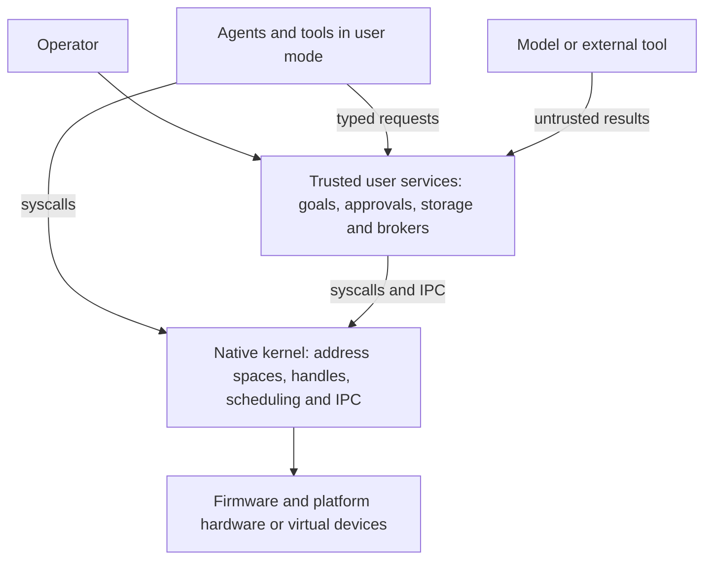

**Figure 4.** Proposed Native architecture. User-mode brokers hold service credentials and enforce goal policy. The kernel checks access to the objects it controls.

The prototype keeps scheduling, syscall dispatch and RamFS in one supervisor kernel. User tasks already have separate address spaces and bounded parent/child messages. Moving a filesystem or policy service into its own process will also require service endpoints, explicit delegation and recovery of committed state with current authority.

### 4.1 Trusted versus untrusted components

| Component | Responsibility |
|---|---|
| Kernel | Memory isolation, scheduling, handle validity, rights checks, bounded queues, revocation and resource enforcement |
| Trusted runtime services | Goal policy compilation, trusted inference accounting, approval UI, transactional storage, durable audit and recovery |
| Agent program | Planning, reasoning, selecting tools, proposing actions |
| Model | Producing suggestions and structured action proposals; never granting itself authority |
| External service bridge | Mediated inference, MCP and explicitly authorized artifact/approval services; no unrestricted host shell or generic network proxy |
| Human/operator | Defines authority, approves sensitive actions, inspects results and controls lifecycle |

The trusted computing base (TCB) includes every component whose compromise can violate the stated guarantee, not just the kernel. Native deployments depend on the processor, firmware, kernel and applicable trusted services. Virtual deployments also depend on the host Linux kernel, KVM or TCG, the VMM, host launcher, policy brokers and artifact publication path. Hosted deployments depend on Linux and the trusted sandbox/control-plane services. Isolate model inference and untrusted tools from these enforcement components. Section 26 defines the threat model.

## 5. Resource and capability model

Replace ambient filesystem and device authority with opaque, kernel-managed handles. A handle is an index or encoded identifier in a per-process capability table; user programs cannot manufacture additional authority by guessing a handle number. Generation counters can prevent stale handles from referring to newly allocated objects.

Illustrative Rust types:

```rust
pub type ObjectId = u64;
pub type AgentId = u64;
pub type GoalId = u64;
pub type ProcessId = u64;

pub enum Resource {
    File(ObjectId),
    Directory(ObjectId),
    Process(ProcessId),
    Agent(AgentId),
    Goal(GoalId),
    Channel(ObjectId),
    Memory(ObjectId),
    Device(ObjectId),
    Model(ObjectId),
    Snapshot(ObjectId),
}

pub struct Rights(pub u32);
impl Rights {
    pub const READ: u32 = 1 << 0;
    pub const WRITE: u32 = 1 << 1;
    pub const EXECUTE: u32 = 1 << 2;
    pub const TRANSFER: u32 = 1 << 3;
    pub const CREATE: u32 = 1 << 4;
    pub const DELETE: u32 = 1 << 5;
    pub const INSPECT: u32 = 1 << 6;
    pub const DELEGATE: u32 = 1 << 7;
}

pub struct Capability {
    pub resource: Resource,
    pub rights: Rights,
    pub goal: GoalId,
    pub generation: u64,
}
```

These fields describe a protected table entry. A caller presents an opaque handle and the handler resolves it in that caller's table. Copying an object ID or a serialized rights mask conveys no authority. The capability specification must also define object lifetimes, derivation lineage and the ordering of revocation against use.

### 5.1 Capability rules

- Default deny: a newly created agent receives no filesystem, network, device or inference authority unless explicitly granted.
- Rights attenuation: a derived capability can grant only a subset of its source rights.
- Delegation: children receive only authority that the parent is permitted to delegate.
- Goal scoping: capabilities can expire at a deadline or when the associated goal ends.
- Revocation: define handle-local close separately from recursive authority revocation. Maintain derivation lineage and check the live goal/capability generation at each authorization boundary. Revocation prevents new grants and new use of revoked rights; it cannot erase data already read. In-flight operations need a documented cancel, drain or reconcile outcome.
- Directory confinement: `open_at` resolves paths relative to an authorized directory handle. Prevent escape through `..`, absolute paths, symlinks, mounts or rename races as applicable.
- Object lifetime: handles cannot silently refer to recycled objects after deletion or restart.
- No ambient bypass: raw device access, arbitrary memory mapping, unrestricted networking, generic proxy tools and privileged IPC must not circumvent restrictions.

Only the boot shell starts with a RamFS working directory (`/`). The initial `hello` task and a plain child start with an empty RamFS handle table and no working directory. A directory grant lets a child use read-only `open_at` within that tree. A goal owner can grant one regular file for reading, restrict delegation and revoke the derived handles. A rename goal can grant staging rights on up to two files. With `--read-under`, even an explicitly granted file must be linked inside the permitted tree at read time. RamFS checks the resolved object on every read by a goal member, including a delegated helper. [Launch and handle initialization](https://github.com/clavenar/core/blob/beef26455e08273389673deec71e6ff2f3e50082/native/kernel/src/scheduler.rs) · [Read confinement in QEMU](https://github.com/clavenar/core/blob/beef26455e08273389673deec71e6ff2f3e50082/docs/qemu-walkthroughs.md#limit-file-reads-to-a-directory)

### 5.2 Intent-based security

Goal-scoped policies answer whether a specific operation is allowed for a particular authorized task, rather than merely whether the user account has permission to access a resource.

```rust
// Conceptual policy, with types to be defined by the implementation.
struct GoalPolicy {
    goal: GoalId,
    resources: CapabilitySet,
    allowed_actions: ActionSet,
    deadline_ticks: u64,
    max_cost_usd_micros: u64,
    requires_approval: ActionSet,
}
```

For a goal such as “summarize the documents in /home/reports”, grant read access to that directory and no write/delete authority. Do not treat the natural-language sentence as an enforceable permission specification. A trusted service and/or human must translate the goal into explicit constraints.

The proposed **Goal Contract Enforcement Architecture (GCEA)** defines how that translation is checked. A planner proposes a contract. A trusted authorizer binds its version, resource scope, permitted effects and limits to the caller's delegable rights. At dispatch the resource handler checks the live grant, remaining budget and applicable preconditions. A backend must reject a contract if it cannot enforce a mandatory condition.

For a file organizer, one checkable condition could permit renaming files within the assigned directory while requiring every input file's contents to survive. A trusted storage service can compare the input snapshot with the staged result independently of the planner. Publication requires that check to pass on the exact diff under review. Claims such as “the files are organized well” remain for the reviewer. [Goal contract responsibilities](../engineering/repository-layout.md#42-goal-contract-enforcement-architecture-gcea)

## 6. Agents and goals as first-class objects

### 6.1 Agent control block

```rust
pub enum AgentState {
    Ready,
    Running,
    WaitingForModel,
    WaitingForEvent,
    WaitingForApproval,
    Suspended,
    Completed,
    Failed,
    Cancelled,
}

pub struct AgentBudget {
    pub cpu_ticks: u64,
    pub memory_pages: usize,
    pub tokens: u64,
    pub tool_calls: u64,
    pub child_agents: usize,
}

pub struct AgentControlBlock {
    pub id: AgentId,
    pub parent: Option<AgentId>,
    pub goal: GoalId,
    pub state: AgentState,
    pub priority: u8,
    pub budget: AgentBudget,
    pub checkpoint_id: Option<u64>,
}
```

This is a logical view of an agent. Each associated process records its agent ID, so an agent can have zero or more live processes. In the Native design the kernel protects identity, process association and local resource limits. The runtime records why an agent is waiting, its definition version, model context and checkpoints. Brokers own reservations and settlement for external spending. Wire representations use fixed-width values and specified units (Section 7).

### 6.2 Goal descriptors

A goal descriptor could be the defining abstraction of Clavenar OS, analogous in spirit to a file descriptor but representing an authorized scope of work.

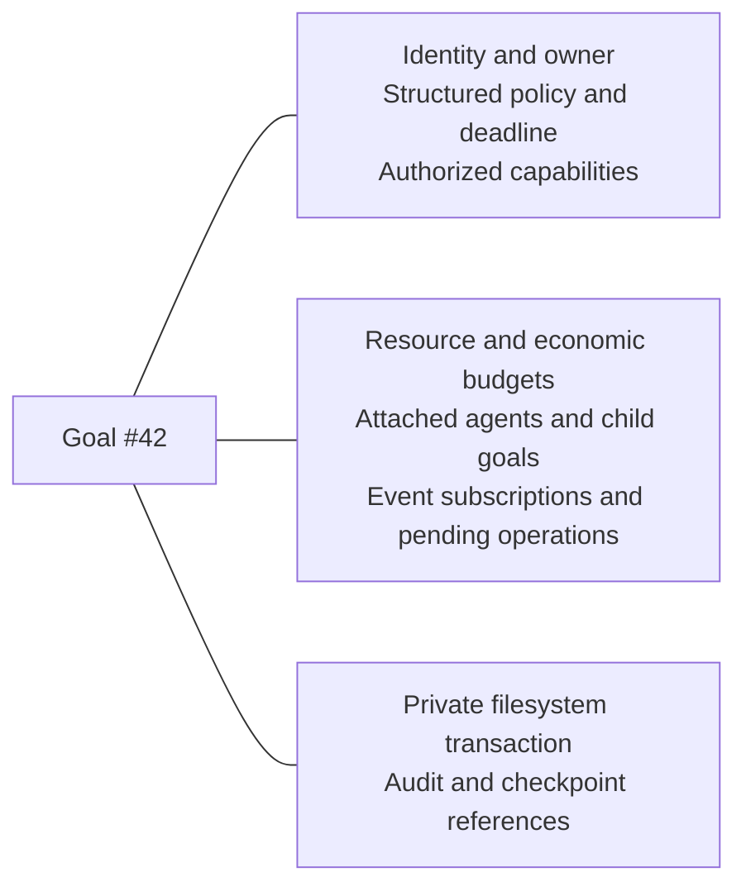

**Figure 6.2.** A goal descriptor holds the authority, participants and state for one goal.

Illustrative user-space API:

```rust
let goal = goal_create("Organize project files", policy, budget)?;
goal_attach(agent, goal)?;
goal_start(goal)?;
let outcome = goal_wait(goal)?;
if outcome.completed() {
    // The reviewer uses its separately granted handle for this goal.
    let diff = goal_diff(review_handle)?;
    goal_commit(review_handle, diff.version())?;
}
```

Explicitly cancelling a goal should propagate cancellation to its children, revoke the relevant authority, cancel supported in-flight requests, release resources, discard uncommitted changes and retain authorized audit history. Closing a handle should normally release a reference; cancellation on last close must be an explicit, documented policy so persistent goals are not accidentally destroyed.

**Cancellation and publication.** Successful completion stops the goal's execution authority. Its private changes can await a separate decision by a reviewer who holds commit authority for that goal (`review_handle` above). The storage service binds publication to the reviewed diff and its base version. Cancellation or expiry can still discard a pending transaction. The authority service orders cancellation against new grants, dispatches and publication. If cancellation wins, it rejects new work and publication. If publication wins, the committed version remains visible. Record the outcome, drain or cancel local work and retain reservations for dispatched external requests until their outcomes are reconciled.

### 6.3 Lifecycle

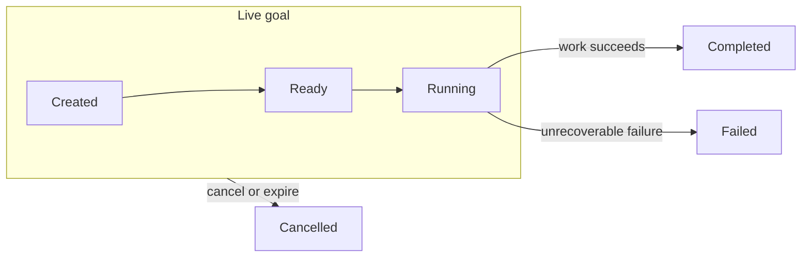

**Figure 6.3.** Proposed goal execution states. Within a running goal, one agent can wait for a model, event or approval while another runs. An agent may be suspended or checkpointed at a safe point. A completed goal can still have a private transaction awaiting review (Section 12).

Agents may live for months without continuously consuming CPU. Use asynchronous event queues and bounded mailboxes instead of polling. Define deadlines, failure propagation, orphan cleanup and safe cancellation points.

## 7. System call and service interface

Keep the kernel ABI small. Many agent operations are better implemented as typed IPC requests to trusted user-space services than as distinct syscalls.

| Interface | Purpose | Suggested placement |
|---|---|---|
| `open_at`, `read`, `write`, `seek`, `close`, `inspect` | Resource access | Kernel or mediated filesystem service |
| `cap_derive`, `cap_transfer`, `cap_revoke` | Capability management | Kernel |
| `map`, `unmap` | Virtual memory | Kernel |
| `spawn`, `exit`, `wait`, `getpid` | Process lifecycle | Kernel |
| `message_send`, `message_recv` | Typed IPC | Kernel |
| `event_subscribe`, `event_wait` | Event-driven execution | Kernel + services |
| `agent_create`, `agent_spawn`, `agent_exit` | Agent identity and lifecycle | Runtime backed by kernel primitives |
| `agent_suspend`, `agent_resume`, `agent_status`, `agent_budget` | Agent control and inspection | Kernel + runtime |
| `goal_create`, `goal_attach`, `goal_start`, `goal_wait`, `goal_cancel`, `goal_commit` | Goal lifecycle | Runtime backed by protected goal objects |
| `model_submit`, `model_wait` | Asynchronous inference | Trusted inference broker |
| `approval_request` | Human authorization | Trusted approval service |
| `snapshot`, `restore`, `checkpoint` | Versioned state and recovery | Storage/runtime services |
| `audit_read` | Authorized provenance inspection | Audit service |
| `pipe`, `dup`, `dup2` (or explicit handle mapping) | Streams and child I/O | Kernel |
| `reflex_install`, `reflex_attach`, `reflex_disable`, `reflex_inspect` | Bounded reactive policy lifecycle | User-space service first, optional verified kernel backend |
| Tool discovery, MCP invocation, definition reload | Application protocols and configuration | User-space services over authenticated IPC |

The table describes the proposed service interfaces. At the Section 21 baseline, `clv-abi` 0.0.21 defines 78 native RV64 syscall numbers, 0–77. `ecall` takes the number in `a7` and up to six arguments in `a0`–`a5`. The primary result is in `a0`, with additional registers defined per call. For example, `wait` returns the child's completion kind and detail, and typed IPC supplies a kernel-authenticated sender identity. [Shared syscall numbers](https://github.com/clavenar/core/blob/beef26455e08273389673deec71e6ff2f3e50082/crates/clv-abi/src/lib.rs) · [Native ABI and wire formats](https://github.com/clavenar/core/blob/beef26455e08273389673deec71e6ff2f3e50082/docs/native-syscall-abi.md)

The versioned ABI should define fixed-width wire types, error values, argument structures, alignment and user-memory copying. Specify the boot ABI separately. Use explicit layouts for shared structures and validate sizes, versions and flags. Other CPU architectures can implement the same logical operations with their own entry instructions and registers.

## 8. Goal-oriented shell

At the native `clsh>` prompt, `help` lists the implemented commands, including `goal create`, `agent run`, `goal diff`, `goal commit` and `goal audit --reads`. The shell tracks its current goal handle. [Runnable shell walkthroughs](https://github.com/clavenar/core/blob/beef26455e08273389673deec71e6ff2f3e50082/docs/qemu-walkthroughs.md)

The following transcript illustrates the **proposed `clv` management CLI** for Native and Hosted. Section 31.6 defines how it would expose backend-specific operations.

```text
clv:/$ clv goal run --policy organizer --transaction "Organize files in /home"
Goal #42 created; agent #7 started
  Scope: /home (read, private write)
  Network: denied; delete: approval required
  Budget: 10000 tokens, 100 actions, 2 child agents
[agent:7] Found 18 files; proposed 3 directories
[agent:7] Private transaction ready for review

clv:/$ clv agent list
ID   STATE             GOAL
7    WAITING_APPROVAL  42
clv:/$ clv goal diff 42
clv:/$ clv goal audit 42
clv:/$ clv goal commit 42
```

Other proposed commands include `clv goal inspect 42`, `clv goal cancel 42`, `clv goal rollback 42`, `clv agent suspend 7`, `clv agent resume 7`, `clv agent inspect 7`, `clv agent replay 7`, `clv agent rewind 7 --checkpoint 8`, `clv reflex list`, `clv reflex inspect 18` and `clv mcp inspect github`. Conventional tools remain usable without an agent. File history and snapshot commands can be added when storage supports them.

## 9. Resource accounting and economic budgets

The operating system should extend traditional resource accounting to the economics of autonomous work. Goals and their descendants share hierarchical budgets. A child receives a reserved subset of its parent's budget, not a fresh independent allowance that can be used to bypass limits.

```yaml
budget:
  memory: 64MiB
  cpu_time: 30s
  filesystem_quota: 32MiB
  tokens: 100000
  inference_requests: 50
  tool_calls: 100
  max_cost_usd_micros: 500000
  child_agents: 4
  deadline: 10min
```

The current native HTTPS service charges request-tagged transmit frames to a goal balance (Section 34.2). Further budget dimensions could include outstanding requests, mailbox size, accelerator time, storage writes, energy and device usage.

All monetary examples use integer millionths of a US dollar. Before dispatch, the trusted inference broker reserves a bound covering billable input, maximum output and applicable fees. A goal requiring a hard cost ceiling can use only providers and request types with an enforceable upper bound. The broker reconciles confirmed usage once and keeps the reservation for an unknown outcome. It holds provider credentials and controls access to the endpoint.

On exhaustion, stop issuing new work, suspend or cancel the agent according to policy, notify its supervisor, preserve its checkpoint if authorized and release unused reservations. Cancellation may not eliminate the cost of an already submitted request.

### 9.1 Accounting and comparison with Linux

Distinguish instantaneous limits (resident memory, outstanding requests) from cumulative consumables (CPU time, charged tokens, spending, tool invocations). Reserve delegated or in-flight consumables atomically and settle them once; reclaimed capacity is not a refund of consumed work. Charge trusted-service work to the originating goal where measurable. Linux cgroups provide the compute portion; the potential Clavenar advantage is unified goal-linked accounting across all mediated endpoints (Sections 18, 31 and 34).

## 10. Agent-aware scheduling and coordination

Keep the CPU scheduler independent of model reasoning. A trusted user-space scheduler can prioritize higher-level work using OS-enforced resource accounting and events.

| Policy | Purpose |
|---|---|
| Goal priority | Prioritize important authorized goals |
| Deadline-aware | Prioritize time-sensitive work |
| Dependency-aware | Run agents blocking other agents |
| Budget-aware | Stop or defer work that exceeds available quotas |
| Model-aware | Batch compatible inference requests and allocate context capacity |
| Cost-aware | Select an authorized model appropriate to cost and task |
| Energy-aware | Preserve battery power and respect thermal or energy constraints |
| Risk-aware | Pause operations requiring approval without holding unnecessary compute resources |

When one agent waits for inference, another can use CPU time, interact with a sensor or process files. Blocked agents should not continuously poll or occupy inference slots they do not need.

### 10.1 Native multi-agent supervision

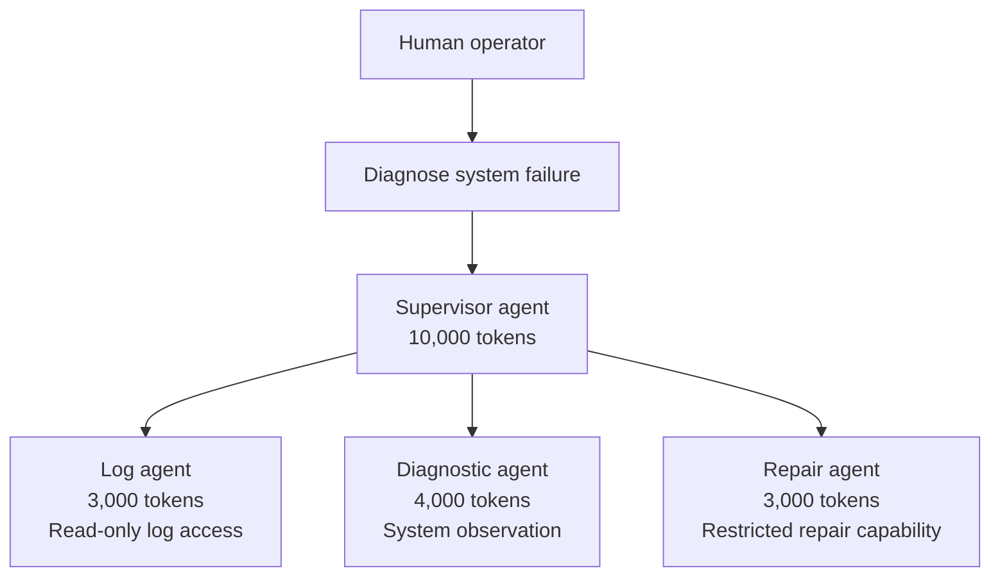

**Figure 10.1.** The three child budgets add up to the supervisor’s 10,000 tokens. Each child receives authority for its own task.

Implement bounded mailboxes, authenticated sender identity, typed messages, agent discovery restricted by authority, supervision trees, cancellation propagation and child cleanup. An agent cannot delegate authority or budget that it does not possess. Shared budgets must be reserved atomically to prevent oversubscription by concurrent children.

The design borrows from actor systems and Erlang-style supervision, combined with OS-level memory protection and resource mediation.

### 10.2 Goal completion versus CPU utilization

Potential optimization targets are deadline attainment, goal completion rate, cost per successful goal, joules per goal and fairness among goal owners. These are higher-level scheduling objectives, not reasons to put an LLM into the CPU scheduler or interrupt handler. A goal's importance must come from authorized policy, not a model claiming urgency.

## 11. Inference architecture

Model inference does not belong in privileged kernel code. Define a provider-independent inference service with bounded requests, asynchronous responses, model capabilities and trusted usage reporting.

| Deployment | Role |
|---|---|
| Deterministic mock | First provider for scripted goals and repeatable policy checks at v0.3 |
| External inference service | First real provider, through the trusted host broker at native v0.4 |
| Small local model on RISC-V | Later experiment with offline operation, privacy and resource constraints |
| Dedicated accelerator | Long-term hardware/software co-design research |

### 11.1 QEMU inference bridge

The RV64 guest can request a deterministic plan or a decision from local Ollama through a dedicated VirtIO console port. The Python broker on the QEMU host reserves a per-session allowance in SQLite before dispatch, records the outcome and returns a bounded reply. The kernel checks the requesting agent’s pinned definition and goal authority. The interactive shell uses the UART. A reusable `modeld` and additional providers are part of the design. [Model-backed plan](https://github.com/clavenar/core/blob/beef26455e08273389673deec71e6ff2f3e50082/docs/qemu-walkthroughs.md#run-a-model-backed-plan) · [Bridge transport](#323-minimal-virtual-hardware-and-bridge)

### 11.2 Safe execution of model outputs

A response is untrusted data, never executable authority. Parse a strict structured schema, validate all arguments and sizes, bind the request to the authenticated agent/goal, then resolve handles and enforce rights before invoking an operation. Reject arbitrary host commands and unrestricted tool proxies. Keep provider credentials outside agent address spaces.

## 12. Transactional autonomy and versioned filesystem

A distinguishing user-facing feature is the ability to inspect and undo an agent's changes. Build on the hierarchical RamFS and eventually a persistent copy-on-write filesystem.

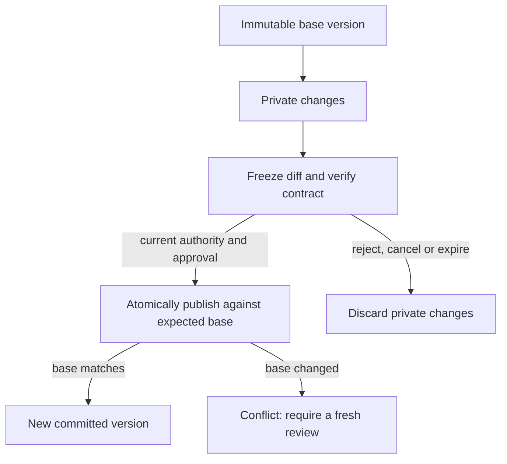

**Figure 12.** Transactional execution flow for goal-scoped private state and publication or discard.

An agent normally writes to a private transaction on an immutable base. Discard releases those changes. At commit the storage service checks the base version, frozen diff, required postconditions, live authority and applicable approval. It serializes this decision with cancellation and a single visible version switch. Each lookup sees a complete root. A reader that needs a consistent view across several lookups pins a version. A base conflict requires a new diff and review. A backend must satisfy the requested visibility and durability guarantees independently. The v0.4 RamFS target provides atomic publication within a boot. The v0.6 persistence gate adds recovery of the committed version after a crash. Section 12.2 covers external effects.

### 12.1 File versions and snapshots

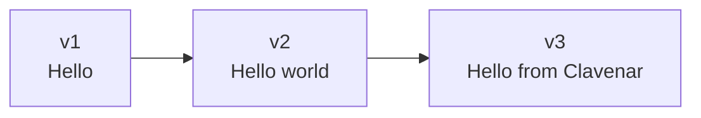

**Figure 12.1.** Successive contents of `notes.txt`.

Proposed operations: `history`, `snapshot`, `restore`, `diff`, `commit` and `rollback`. Use bounded version retention and charge snapshot storage to goals. A simple RamFS prototype can copy the full filesystem for a small number of transactions; page/block-level copy-on-write is a later optimization. A persistent implementation needs journaling or equivalent crash-consistent commit semantics, reference counts, garbage collection and recovery tests.

### 12.2 Irreversible actions

Filesystem rollback does not undo sent messages, leaked data, purchases or physical actions. Such effects should be explicitly classified and authorized, potentially through a prepare/approve/execute protocol. Use idempotency keys where endpoints support them; after a crash, uncertain external effects may require reconciliation rather than automatic retries.

Linux already supports overlay filesystems, snapshots and copy-on-write storage. The potential Clavenar OS advantage is making private state, diff review, commit authority and rollback part of the normal goal lifecycle rather than optional application conventions.

## 13. Observability, audit and time-travel debugging

Record the authenticated caller, target resource, operation, policy decision, outcome, sequence number and timestamp or logical clock. Include the goal for goal-owned work and the agent identity when one exists. A conventional child process is attributable to its goal without being assigned an agent identity. Reject an operation requiring a goal if the caller lacks a protected goal binding. Include approved changes to authority and budget.

Potential replay data includes:

- Model requests and responses, or approved redacted representations.
- System calls and their results.
- External observations and event ordering.
- Inter-agent messages and scheduling decisions relevant to replay.
- Capability grants, derivations and revocations.
- Filesystem version identifiers, diffs and transaction outcomes.
- Human approval decisions and budget consumption.

Example event sequence:

```text
00:00.000  Goal #42, agent #7 created; budget assigned
00:00.015  Directory scanned; 18 files found
00:01.240  Model proposal received
00:01.250  Checkpoint #8 created
00:01.310  Private file update authorized
00:01.350  Delete denied: missing authority
00:01.400  Agent suspended pending human approval
```

Audit logs should be append-only to ordinary agents, access-controlled, bounded, durable where required and optionally hash-chained or exported to an independent verifier. Distinguish the early volatile guest event log from the durable host operations/accounting journal. Require durable reservation and dispatch records before real external side effects in the bridge; do not label a volatile guest audit trail as crash-proof. Hash chains alone do not protect against truncation or a compromised trusted writer. Avoid logging secrets unnecessarily; define retention, encryption and redaction policies.

### 13.1 Replay and inspection

Replay can substitute recorded model responses and external inputs for live requests. Accurate deterministic replay requires recording or controlling all relevant sources of nondeterminism, including timing, random numbers, interrupts and concurrency. Replaying a run must not resend real external actions by default. Logical agent checkpoints are easier to implement than complete process or system snapshots.

### 13.2 Agent-native virtual filesystem

```text
/
|-- agents/
|   |-- 1/
|   |   |-- goal
|   |   |-- status
|   |   |-- budget
|   |   |-- capabilities
|   |   |-- context/
|   |   |-- memory/
|   |   |-- inbox/
|   |   |-- checkpoints/
|   |   `-- audit/
|   `-- 2/
|-- goals/
|   |-- pending/
|   |-- active/
|   `-- completed/
|-- models/
|   |-- local/
|   `-- remote/
|-- tools/
|   |-- filesystem/
|   |-- network/
|   `-- sensors/
|-- events/
|-- approvals/
|-- snapshots/
|-- sys/
|   |-- kernel/       version, uptime, syscalls
|   |-- cpu/          architecture, harts
|   |-- memory/       total, free, pages
|   |-- processes/    status, memory, capabilities, threads
|   |-- devices/
|   `-- snapshots/
|-- dev/
|-- bin/
|-- etc/
|-- tmp/
`-- home/
```

These are conceptual virtual interfaces backed by kernel objects or runtime services, not ordinary files that an agent may edit to grant itself permission. Sensitive context, register contents, audit records and resource information require explicit inspection rights. The design combines Plan 9-inspired resource interfaces with agent-oriented lifecycle management.

## 14. Persistence, recovery and self-maintenance

Treat agent identity and logical state separately from a currently running process. Persist goals, policy references, budgets, event subscriptions, checkpoints, context and pending operation identifiers. On reboot, verify restored authority against current policy, reconcile unfinished operations and resume only authorized work.

Use isolated, restartable services and supervisor trees. Example system agents:

| Agent | Responsibility |
|---|---|
| Memory agent | Diagnose memory pressure and suggest mitigation |
| Storage agent | Observe capacity, integrity and recovery status |
| Security agent | Investigate suspicious audit events |
| Network agent | Diagnose connectivity |
| Energy agent | Propose power and scheduling adjustments |
| Recovery agent | Restart authorized failed services |
| Update agent | Evaluate and stage approved updates |

A maintenance agent may diagnose a fault, propose a change, stage it, validate the result and request a commit. Deterministic watchdogs, safety controllers, interrupt handlers and resource enforcement remain independent of agents. Avoid giving maintenance agents unrestricted privilege escalation or the ability to modify their own security policy.

## 15. Information-flow control and data sovereignty

Resource access alone does not prevent an authorized reader from transmitting sensitive information to an authorized external endpoint. Add explicit information-flow policies and mediate inference requests as data egress.

```rust
enum SecurityLabel {
    Public,
    Internal,
    Confidential,
    Secret,
}
```

Example policy (configurable, not universal):

| Label | Permitted processing |
|---|---|
| Public | Authorized local or cloud inference |
| Internal | Approved inference providers |
| Confidential | Local inference only |
| Secret | No external transmission; tightly controlled local processing |

Native v0.4 restricts which resources and endpoints a goal may use. An approved model or tool can still receive any data the caller is allowed to send. For the later label-based profile, a conservative starting point is to classify the whole goal before admitting sensitive inputs. Apply that classification to children, IPC recipients, inference, tools, logs and artifact export. Decline a workload if a required channel cannot enforce the label. Finer tracking and explicit declassification need separate evidence under the threat model.

## 16. Human approval and prompt-injection containment

Agents may misinterpret a goal or be manipulated by malicious instructions embedded in files, webpages, messages or model outputs. The system should remain safe even when a model proposes an unauthorized operation.

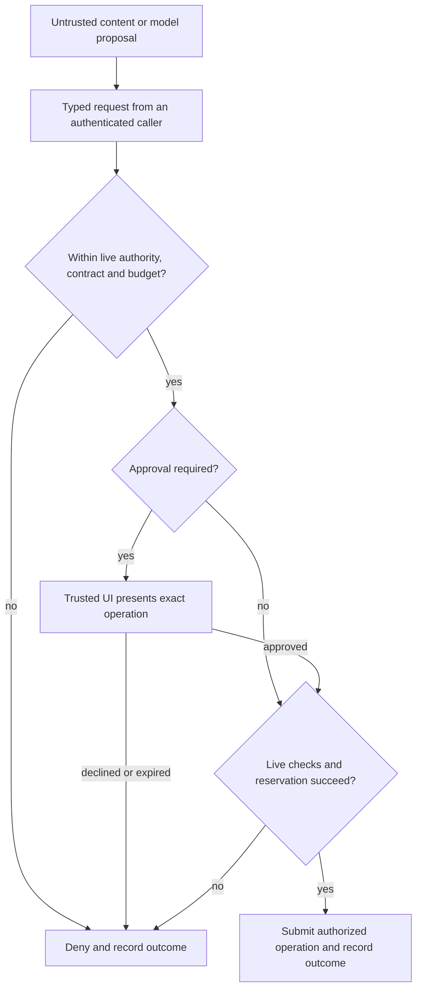

**Figure 16.** Validation and authorization flow for untrusted model-proposed operations.

Approval satisfies an additional condition on an already authorized operation. Bind it to the caller and goal, the canonical operation and arguments, target and relevant versions, and an expiry. The trusted dispatcher checks current rights and consumes the approval once for that operation. A changed target, diff or base requires fresh review. An authorized operator can grant additional rights through a separate, audited delegation. Protect the trusted approval UI from agent spoofing.

### 16.1 Example policy for a file organizer

| Operation | Policy |
|---|---|
| Read files in assigned directory | Allow |
| Modify files inside private transaction | Allow |
| Delete files | Require approval |
| Network access | Deny |
| Raw device access | Deny |
| Spawn child agents | Deny unless explicitly granted |
| Publish filesystem changes | Require commit authority |

This design limits the consequences of prompt injection; it does not eliminate prompt injection or guarantee a model's decisions are correct. An agent can still misuse its legitimately granted authority. Policy design, narrow capabilities, staged effects and independent validation remain important.

## 17. Why RISC-V and Rust?

The current RV64 platform is QEMU `virt` with OpenSBI. Bringing up a physical RISC-V board requires a compatible firmware handoff, memory map, interrupt and timer support, and drivers for its devices. [Platform targets](../engineering/repository-layout.md#10-abi-protocols-and-platform-targets)

| RISC-V property | Potential benefit |
|---|---|
| Open instruction set | Architectural experiments and hardware/software co-design |
| RV64 privilege levels | Separate untrusted user programs from supervisor enforcement |
| Sv39 virtual memory | Hardware-enforced address-space isolation on compatible processors |
| Physical Memory Protection (PMP) | Firmware/machine-mode physical access restrictions where supported |
| Vector extensions | Potential acceleration of suitable inference workloads on supporting hardware |
| Custom extensions | Research into specialized security and agent operations |
| FPGA implementations | Prototype hardware extensions |
| Embedded ecosystem | Autonomous edge and sensor devices |

Rust offers memory-safe abstractions, explicit ownership, `no_std` support and strong type systems for handles and protocol messages. Unsafe operations remain necessary for traps, MMIO, paging, DMA and context switching; isolate and audit them. Rust alone does not provide process isolation, secure capabilities or protection from logical policy mistakes.

### 17.1 Long-term hardware research

- Hardware-tagged or hardware-assisted capabilities.
- Precise per-agent resource and energy accounting.
- Protected memory regions and hardware-backed identities.
- Hardware-assisted snapshots and event queues.
- Dedicated inference acceleration and memory bandwidth management.
- FPGA-based experiments and custom ISA extensions.

These are research directions, not properties of ordinary RISC-V processors. Linux can also run on RISC-V and exploit many of the same hardware features; the differentiator is the combined system design.

## 18. Potential advantages over Linux

Clavenar OS is not intended to replace Linux for general-purpose computing. Linux is mature, flexible and capable of supporting agent-oriented security through existing mechanisms and carefully designed services. Clavenar OS proposes a specialized environment whose abstractions make these mechanisms consistent and mandatory for agent workloads.

| Potential advantage | Why it matters | Linux equivalent or alternative | Clavenar OS design opportunity |
|---|---|---|---|
| Prompt-injection containment | Limits damage from manipulated agents | Landlock, seccomp, LSMs, sandboxing, VMs | Default-deny capabilities and mandatory action mediation |
| Goal-scoped authority | Avoids permanent excessive permissions | Scoped credentials, brokers, sandbox policies | Goal-linked rights, expiry and cancellation |
| Economic accounting | Prevents uncontrolled inference spending | Application quotas, cgroups for compute | Unified hierarchical budgets for compute, tokens, cost and actions |
| Transactional autonomy | Protects original state during autonomous work | OverlayFS, Btrfs, other snapshot systems | Private transaction attached to a goal's lifecycle |
| Time-travel debugging | Makes nondeterministic failures easier to study | Tracing, recording, checkpoint tools | Goal-linked events, inference replay and resource versions |
| Smaller trusted computing base | May simplify verification and security reviews | Minimal Linux systems, hardened configurations, microVMs | Small clean-slate kernel and explicitly trusted services |
| Multi-agent supervision | Restricts delegation and prevents orphan work | IPC, process trees, service managers, runtimes | Agent identities, scoped delegation, cancellation propagation |
| Agent-aware scheduling | Coordinates inference, CPU and waiting states | User-space schedulers and inference servers | Unified events and goal-based accounting |
| Persistent agents | Resume long-running work after failures | CRIU, databases, durable workflow runtimes | Standard logical checkpoint and recovery protocol |
| Autonomous maintenance | Enables adaptive system diagnostics | Monitoring, service managers, repair scripts | Restricted agents with auditable, staged repair operations |
| Data sovereignty | Restricts transmission of sensitive context | LSMs, network policies, DLP, application brokers | Goal-linked data labels and mediated inference egress |
| Hardware co-design | Enables architecture-specific experiments | Linux on custom hardware | Minimal, focused platform for experimenting across the stack |
| Embedded resource efficiency | May reduce memory and boot overhead | Embedded Linux, RTOSs, unikernels | Specialized software footprint and device-specific agent runtime |
| Unified approval mechanism | Makes sensitive actions reviewable | Application-specific approval workflows | Standard operation-bound approval service |
| Versioned syscall ABI | Makes the user/kernel contract explicit | Linux syscall ABI and typed user-space wrappers | Fixed-width wire types and checked Rust wrappers for native handles |
| Goal descriptors | Makes authorized work a named, manageable resource | Process groups, cgroups, jobs, workflow runtimes | Unified lifetime for authority, budgets, agents, transactions and audit |

### 18.1 Where Linux is stronger

Linux has major advantages in hardware compatibility, networking, storage performance, mature drivers, application availability, GPU and accelerator support, production stability, debugging infrastructure, established security engineering and AI framework compatibility. A young OS is unlikely to outperform it generally. Even specialized latency, boot, memory and energy advantages are hypotheses requiring fair measurements.

A Linux runtime could reproduce most of the proposed semantics using namespaces, cgroups, seccomp, Landlock, capability-oriented brokers, storage snapshots and durable workflow services. The meaningful comparison is not an unsecured Linux process versus a hardened Clavenar OS agent. It is Clavenar OS versus a well-engineered, hardened Linux implementation providing equivalent guarantees.

## 19. Application domains

| Domain | Example workload | Key requirement |
|---|---|---|
| Autonomous robotics | High-level navigation, planning and coordination | Deterministic motion controllers and independent safety interlocks |
| Industrial edge devices | Sensor analysis, diagnostics and maintenance proposals | Strict device capabilities and bounded actions |
| IoT gateways | Local monitoring and event-driven autonomous tasks | Memory, network and energy limits |
| Remote devices | Agents persist through intermittent connectivity | Logical checkpoints and safe recovery |
| Self-managing computers | Diagnose faults, inspect logs and restart services | Transactional repair and auditable decisions |
| Distributed autonomous systems | Coordinate tasks among RISC-V nodes | Authenticated IPC, scoped delegation, failure handling |
| AI appliances | Dedicated agent execution environment | Data sovereignty and standardized resource budgets |
| Research and education | Study agent reliability, OS design and security | Reproducible experiments and inspectable abstractions |

Distributed resources could eventually be exposed through a Plan 9-inspired virtual filesystem. Remote capability transfer would need authenticated peers, bounded delegation, revocation semantics, network failure handling and explicit trust boundaries.

## 20. Research context and novelty

The individual concepts are not unprecedented. Relevant areas include capability systems, formally verified microkernels, actor systems, transactional storage, deterministic replay, checkpoint/restart, durable workflows and LLM agent runtimes.

| Existing system or concept | Relevant lesson |
|---|---|
| Linux | Mature general-purpose kernel and security mechanisms; primary comparison baseline |
| Redox OS | Rust-oriented microkernel and resource interfaces |
| seL4 | Capability-based access control and formal verification |
| Plan 9 | Composable filesystem namespaces and distributed resource interfaces |
| Fuchsia/Zircon | Handle-based access and isolated components |
| TempleOS | Example of a distinctive integrated OS philosophy, not a security model |
| Erlang/OTP and actor systems | Supervision, message passing and fault recovery |
| AIOS | Agent-oriented inference and resource scheduling above a host OS |
| Agent libOS | Yingqi Zhang describes a runtime with explicit authority, process-local agent state and checkpointing. [Agent libOS, arXiv v3](https://arxiv.org/abs/2606.03895v3) |
| AgenticOS | Zhen Zhao and colleagues propose deriving mediated execution environments from structured intent declarations. [AgenticOS, arXiv v1](https://arxiv.org/abs/2606.21129v1) |
| Linux eBPF | Verified restricted programs attached to system events; comparison baseline for reflexes |
| WASI / WebAssembly | Portable modules with explicit host interfaces |
| MCP | Standard tool and context interoperability |
| CRIU | Linux process checkpoint and restore |

The proposed distinction is a bare-metal Rust system (RISC-V first) designed from the hardware privilege boundary upward around goal-scoped authority, bounded autonomy, transactional changes and accountable execution. A claim of being the first such OS would require a dedicated literature and prior-art review. The project name also needs an availability and trademark check before public branding.

### 20.1 Background references for further investigation

These primary sources describe the mechanisms used for comparison.

- [RISC-V Supervisor ISA, version 1.13](https://docs.riscv.org/reference/isa/v20260120/priv/supervisor.html)
- [OpenSBI](https://github.com/riscv-software-src/opensbi)
- [Linux cgroups v2](https://docs.kernel.org/admin-guide/cgroup-v2.html)
- [Linux Landlock](https://docs.kernel.org/userspace-api/landlock.html)
- [Linux seccomp](https://docs.kernel.org/userspace-api/seccomp_filter.html)
- [Linux OverlayFS](https://docs.kernel.org/filesystems/overlayfs.html)
- [CRIU checkpoint/restore project](https://github.com/checkpoint-restore/criu)
- [seL4](https://sel4.systems/)
- [Redox OS](https://www.redox-os.org/)
- [Fuchsia](https://fuchsia.dev/)
- [Plan 9](https://9p.io/plan9/)
- [Erlang/OTP supervision](https://www.erlang.org/doc/system/sup_princ.html)
- [AIOS paper by Kai Mei and colleagues](https://arxiv.org/abs/2403.16971v5) and [project repository](https://github.com/agiresearch/AIOS)
- [OASIS Virtual I/O Device specification, version 1.2](https://docs.oasis-open.org/virtio/virtio/v1.2/virtio-v1.2.html)

## 21. RV64 prototype and verification baseline

The examples below use published Core revision `beef264`, kernel 0.1.4 and `clv-abi` 0.0.21. The guest boots on QEMU `virt` with OpenSBI and one RV64 hart. The package version identifies this build. Section 23 defines the cumulative release gates. [Core at `beef264`](https://github.com/clavenar/core/tree/beef26455e08273389673deec71e6ff2f3e50082) · [Build and boot](https://github.com/clavenar/core/blob/beef26455e08273389673deec71e6ff2f3e50082/README.md#build-and-run-the-rv64-kernel)

| Area | What runs in this revision | Scope and reproduction |
|---|---|---|
| Isolation and scheduling | Five user ELFs (`hello`, the shell, `echo`, `grep` and `netd`) supply seven fixed task slots. Each slot has its own Sv39 root and private stack. Three slots share the executable pages of `echo`. | The quickstart starts `hello` and the shell. The network service starts when a modern VirtIO NIC initializes. [Boot, stacks and image limits](https://github.com/clavenar/core/blob/beef26455e08273389673deec71e6ff2f3e50082/docs/qemu-walkthroughs.md#boot-and-shell) |
| Files, IPC and authority | Only the boot shell starts with a RamFS working directory. It can grant file or confined directory handles. Typed messages and bounded stdin/stdout pipes connect native tasks. | RamFS has four writable files of up to 256 bytes each, four directories besides root and four handles per task. A goal can further restrict reads to a directory. [RamFS](https://github.com/clavenar/core/blob/beef26455e08273389673deec71e6ff2f3e50082/docs/native-syscall-abi.md#ramfs) · [Bounded streams](https://github.com/clavenar/core/blob/beef26455e08273389673deec71e6ff2f3e50082/docs/qemu-walkthroughs.md#send-data-through-stdin-and-stdout) |
| Goals and publication | One open goal admits one agent and up to three member launches over its lifetime. A separate supervisor can review up to two staged renames. A read-only monitor can report the outcome. The shell owns the final commit. | Each rename stays in the source file’s directory. Review binds the staged batch and base revision. A failed preservation check or a stale review blocks publication. [Worker, supervisor and monitor](https://github.com/clavenar/core/blob/beef26455e08273389673deec71e6ff2f3e50082/docs/qemu-walkthroughs.md#observe-a-reviewed-publication) |
| Planning and tools | `find-greeting@2` invokes `text.search@1` over native messages. Revision 4 uses local MCP over stdio. Revision 8 can combine Ollama, local MCP and an approved host MCP call in one goal. | The latter uses an allowlisted loopback fixture and a per-session SQLite journal for model usage and host tool calls. The guest can run this scenario with `-nic none`. [Local MCP](https://github.com/clavenar/core/blob/beef26455e08273389673deec71e6ff2f3e50082/docs/qemu-walkthroughs.md#invoke-a-registered-file-tool-over-mcp) · [Combined run](https://github.com/clavenar/core/blob/beef26455e08273389673deec71e6ff2f3e50082/docs/qemu-walkthroughs.md#run-ollama-and-both-mcp-searches-in-one-goal) |
| Persistence and recovery | With a dedicated VirtIO block image, a reviewed commit can persist one or two root-level files. A local search can resume from a checkpoint. A host search can recover a recorded receipt with the same checkpoint disk and host journal. | Each walkthrough uses a purpose-specific image. A host request with an unknown outcome keeps its reservation. [Durable rename batch](https://github.com/clavenar/core/blob/beef26455e08273389673deec71e6ff2f3e50082/docs/qemu-walkthroughs.md#persist-two-renames-in-one-commit) · [Local checkpoint](https://github.com/clavenar/core/blob/beef26455e08273389673deec71e6ff2f3e50082/docs/qemu-walkthroughs.md#resume-a-local-search-checkpoint) · [Host checkpoint](https://github.com/clavenar/core/blob/beef26455e08273389673deec71e6ff2f3e50082/docs/qemu-walkthroughs.md#recover-a-host-mcp-search-checkpoint) |
| Native networking | `netd` handles Ethernet, ARP, IPv4, ICMP, UDP and TCP. With `tls-probe`, separate grants admit HTTPS GET, MCP initialization, tool discovery or a `text.search` call. | The build profile supplies an IPv4 route, resolver and up to two HTTPS peers with separate trust anchors. Each goal uses its selected peer and can cap its cumulative HTTPS transmit bytes. QEMU calls both peers and compares the kernel transmit counter with the frames on the link. [Peer selection walkthrough](https://github.com/clavenar/core/blob/beef26455e08273389673deec71e6ff2f3e50082/docs/qemu-walkthroughs.md#select-an-https-peer-per-goal) |

### 21.1 Reproduce the baseline

From the Core repository root at `beef264`, build the default kernel and start QEMU with `-nic none`. Look for `Clavenar kernel booted (v0.1.4)`, five `User ELF loaded entry=` lines, `Sv39 paging enabled` and the `clsh>` prompt. Enter the following commands at that prompt on a fresh boot. [Build and run](https://github.com/clavenar/core/blob/beef26455e08273389673deec71e6ff2f3e50082/README.md#build-and-run-the-rv64-kernel)

```text
goal create --children 2 --allow-tool text.search@1 --read-bytes 18 --reply-bytes 36
goal grant-file --delegate-to grep --argument Hello /hello.txt
agent run hello --mock find-greeting@2
wait hello
recv hello
agent status
goal audit
goal audit --reads
goal budget
goal close
```

The wait reports exit 0 and the reply prints `Hello from RamFS`. Check for `definition=find-greeting@2 sha256=` in the status and `caller=agent` and `tool=text.search@1` in the delegation audit. The helper reads 18 bytes. Sending the result to the agent and forwarding it to the shell spends 36 reply bytes. The final outputs report `read_bytes=18` and `available=0 reserved=0 spent=36`.

### 21.2 Sv39 and isolation

Sv39 uses three page-table levels with 512 eight-byte entries per table. Bits 63–39 of a virtual address must equal bit 38. The base page size is 4 KiB, with 2 MiB and 1 GiB superpages available. The supervisor selects the translation mode and root with `satp` and synchronizes address translation with `sfence.vma`. The prototype uses 4 KiB leaves and changes the active root on a task switch. [RISC-V Supervisor ISA](https://docs.riscv.org/reference/isa/v20260120/priv/supervisor.html) · [Address-space implementation](https://github.com/clavenar/core/blob/beef26455e08273389673deec71e6ff2f3e50082/native/kernel/src/memory/sv39.rs)

### 21.3 Historical baseline of 25 November 2026

Core revision `43e2b2c` builds kernel 0.0.1 for one RV64 hart on QEMU `virt` with OpenSBI. The package version identifies this prototype. Native v0.1 and v0.2 in Section 23 are release gates with additional evidence requirements. [Core source at the reviewed revision](https://github.com/clavenar/core/tree/43e2b2c20b4c271a2e90589607936dd14b6da5e8)

| Area | Implemented at this revision | Boundary |
|---|---|---|
| Boot and memory | A fixed pool of 21 frames supplies boot mappings and loaded images. Each task has an Sv39 root, read/execute user code and a private 4 KiB read/write, non-executable stack. Kernel and UART mappings are supervisor-only. | Syscalls copy nonempty buffers only within the current task’s stack. General user mappings and dynamic process allocation are future work. [Memory code](https://github.com/clavenar/core/blob/43e2b2c20b4c271a2e90589607936dd14b6da5e8/native/kernel/src/memory/sv39.rs) · [User copying](https://github.com/clavenar/core/blob/43e2b2c20b4c271a2e90589607936dd14b6da5e8/native/kernel/src/memory/usercopy.rs) |
| Programs and scheduling | The build produces three separate static ELF64 images and embeds them in the kernel. The loader accepts one read/execute segment up to 8 KiB per program. Timer interrupts schedule runnable tasks round-robin. | The three task slots are fixed. `hello` and the shell start at boot. The shell can launch `hello` and `echo` by selector and collect each child’s completion. [Entry and boot programs](https://github.com/clavenar/core/blob/43e2b2c20b4c271a2e90589607936dd14b6da5e8/native/kernel/src/main.rs) · [ELF loader](https://github.com/clavenar/core/blob/43e2b2c20b4c271a2e90589607936dd14b6da5e8/native/kernel/src/memory/user_image.rs) · [Scheduler](https://github.com/clavenar/core/blob/43e2b2c20b4c271a2e90589607936dd14b6da5e8/native/kernel/src/scheduler.rs) |
| Files and authority | Volatile RamFS has two read-only boot files, four writable file slots of 256 bytes each and four directory slots in addition to root. Each task has four handle slots with independent cursors. | Ordinary tasks start at `/`. A directory-scoped child uses read-only `open_at` relative to its grant. The parent can close its handle while the child continues using its own. [RamFS](https://github.com/clavenar/core/blob/43e2b2c20b4c271a2e90589607936dd14b6da5e8/native/kernel/src/fs/ramfs.rs) · [Task handles](https://github.com/clavenar/core/blob/43e2b2c20b4c271a2e90589607936dd14b6da5e8/native/kernel/src/fs/ramfs/handles.rs) |
| IPC and shell | The `clv>` shell can send a launch request, receive a reply and wait for a particular child. Each request or reply holds up to 64 bytes and carries a kernel-assigned sender ID. | This protocol connects the shell with its children. General channels, pipes, events and agent identities belong to later milestones. [Boot ABI](https://github.com/clavenar/core/blob/43e2b2c20b4c271a2e90589607936dd14b6da5e8/crates/clv-abi/src/lib.rs) · [Shell commands](https://github.com/clavenar/core/blob/43e2b2c20b4c271a2e90589607936dd14b6da5e8/userspace/shell/main.rs) |

#### Reproduce kernel 0.0.1

Use the build and QEMU commands for the pinned revision. At boot, look for `Clavenar kernel booted (v0.0.1)`, a loaded entry for each of the three programs, `Sv39 paging enabled` and the `clv>` prompt. In a fresh boot, enter the following commands at that prompt. [Build and run instructions](https://github.com/clavenar/core/blob/43e2b2c20b4c271a2e90589607936dd14b6da5e8/README.md)

```text
mkdir /notes
write /notes/report scoped-ok
askat hello /notes report
wait hello
askat hello /notes ../hello.txt
wait hello
ask echo ping
wait echo
exit
```

The first `askat` prints `scoped-ok` and `hello` exits with status 0. The second prints `cannot read requested file` and `hello` exits with status 1 even though `/hello.txt` exists. `echo` replies `ping` and exits with status 0. After `exit`, the kernel prints `all tasks exited`. A clean build with Rust 1.100.0, QEMU 10.0.13 and OpenSBI 1.6 produced these results on 25 November 2026. Section 26.3 describes the broader security evidence required for later releases.

## 22. Repository structure

| Repository | Responsibility |
|---|---|
| `clavenar/core` | RV64 kernel and linker in `native/`, shared syscall definitions in `crates/clv-abi/`, and wrappers, shell, worker programs and `netd` in `userspace/`. The QEMU host broker lives in `platforms/qemu-riscv64-virt/`. |
| `clavenar/specifications` | Canonical architecture, engineering layout and future normative security and protocol documents. |
| `clavenar/website` | Project site and documentation navigation. |

The engineering layout defines the target paths for Hosted, Virtual, shared services and schemas. Shared services have one implementation with backend adapters. Core owns executable schemas and tests as they are added. Specifications owns their normative semantics and references the applicable Core revision. [Repository layout](../engineering/repository-layout.md)

## 23. Development roadmap

This is the master delivery roadmap for Clavenar OS, not just for the agent runtime or MCP. Deliver a bootable native RV64 kernel from the beginning, test it continuously in QEMU, and publish incremental OS releases as the relevant exit criteria are met. Conventional kernel foundations and independent userland precede the first secure autonomous workloads. The Linux-hosted runtime is complementary and must not block the native OS release sequence.

### 23.1 Native implementation phases

The current RV64 build exercises reviewed publication and host-backed inference and MCP from phases 9–10. Phases 11–14 have bounded examples of offline replay, a read-denial watch, durable publication and checkpoint recovery. Phase 15 supports read-only MCP invocation over guest DNS, TCP and TLS. The build profile supplies the IPv4 route, resolver and up to two HTTPS peers. QEMU verifies off-subnet DNS and HTTPS, calls to both peers in one boot and enforcement of a finite HTTPS transmit budget. Validation on deployed networks remains open. Each release requires all of its exit criteria and those of earlier releases. [MVP evidence](#241-demonstration-scenario) · [Offline replay](https://github.com/clavenar/core/blob/beef26455e08273389673deec71e6ff2f3e50082/docs/qemu-walkthroughs.md#replay-a-combined-goal-offline) · [Read-denial watch](https://github.com/clavenar/core/blob/beef26455e08273389673deec71e6ff2f3e50082/docs/qemu-walkthroughs.md#watch-for-a-read-scope-denial) · [Native networking](#342-native-networking-at-v07)

| Phase | Deliverable | Exit criterion |
|---|---|---|
| 0 | Bring up the kernel, RamFS and shell | Reproduce a QEMU boot and exercise filesystem and shell commands. Section 21 records the current smoke check. |
| 1 | Physical frame allocator and boot hardening; HAL boundaries | Reserved memory protected; architecture-neutral unit tests |
| 2 | Sv39, trap frames and safe user copying | User-mode access to supervisor memory reliably faults |
| 3 | Timers, scheduler, ELF loader and independent userland | Multiple isolated programs run and exit |
| 4 | Capability tables and `open_at` | Rights attenuation and directory confinement tested |
| 5 | Typed IPC, pipes, events and explicit child handles | Bounded messages, blocking/wakeup and authenticated identity |
| 6 | Goal and agent identities/lifecycles | Create, suspend, inspect, cancel and clean up |
| 7 | Hierarchical budgets and supervision | No budget oversubscription; child authority cannot expand |
| 8 | Mock inference, tool registry, pinned definitions, initial goal contracts and action audit. Begin AMD64 bring-up in parallel. | A scripted goal runs within authorized scope and limits. Its resource handler rejects an out-of-contract effect and records the decision. |
| 9 | Private RamFS transactions, independent checks and approval service | Commit binds the validated change set, base version and approval. A changed base or failed mandatory postcondition prevents publication. Discard preserves the base. |
| 10 | Local MCP stdio and host inference/MCP bridge | Real model and mediated remote tools without guest networking |
| 11 | Extended audit, provenance and controlled replay | Recorded run inspectable and replayable without real effects |
| 12 | Bounded user-space reflex engine. Evaluate selected kernel helpers separately. | Demonstrate bounded work, revocation and event-storm control. Privileged execution has additional gates in Section 28.3. |
| 13 | VirtIO block and durable transactions | Committed state survives reboot; crash recovery tested |
| 14 | Durable agent checkpoints and restartable services | Recovery without duplicate external actions |
| 15 | VirtIO-net, smoltcp, HTTP/TLS and native remote MCP | A goal invokes an authorized remote tool over guest DNS and HTTPS. Raw NIC access stays confined to the trusted network service. |
| 16 | Information-flow controls and stronger assurance | Restricted egress and adversarial tests |
| 17 | Expanded AMD64 deployment and platform assurance | Same logical ABI and policy conformance tests across supported architectures |
| 18 | Wasm/WASI, selected hardware and local inference | Portable tool and agent execution; measured device overhead |
| 19 | Distributed agents and hardware acceleration experiments | Evaluated research prototypes |

### 23.2 Native OS release milestones

These are proposed software release gates. Each release carries forward earlier required phases and their regression checks. Native v0.1 can ship with conventional userland. Native v0.5 requires bounded reflexes in user space. Adding a privileged reflex engine requires verifier and helper safety evidence, bounded aggregate event cost and a measured reason to move that work into the kernel. Virtual milestones have their own gates.

| Release | Phases introduced | Milestone | Required deliverable and release gate |
|---|---|---|---|
| Internal prototype | 0 | Bootable kernel | Reproducible RV64/QEMU build and boot, UART, hierarchical RamFS, syscall and shell smoke tests. Not safe for untrusted programs. |
| v0.1 | 1–3 | Clavenar OS — Foundation | Bootable RV64 OS with physical memory allocation, Sv39, safe user copying, timer scheduling, ELF loading, isolated processes, filesystem and shell. Demonstrate independently compiled user programs running and exiting. |
| v0.2 | 4–5 | Clavenar OS — Secure Core | Per-process capability tables, confined file access, typed IPC, pipes, bounded queues and events. Demonstrate denied unauthorized access, rights attenuation and authenticated IPC. |
| v0.3 | 6–8 | Clavenar OS — Agent Core | Demonstrate a goal with ordinary child processes, scoped effects, cancellation, hierarchical budgets, supervision, pinned agent definitions, a tool registry, deterministic mock inference and attributed audit records. Begin AMD64 boot and HAL work in parallel. |
| v0.4 | 9–10 | Clavenar OS — Agentic MVP | Pass Section 24 with a restricted host inference bridge, local and remote MCP, private RamFS transactions, independent contract checks and operation-bound approvals. The host journals real external requests and spending. Durable guest recovery belongs to v0.6. |
| v0.5 | 11–12 | Clavenar OS — Reflex | Extended audit and controlled replay, plus a bounded user-space reflex that responds without inference. Demonstrate revocation and event-storm controls. A kernel backend is conditional on the additional evidence above. AMD64/KVM Goal Machines target the independent Virtual V0.5 gate. |
| v0.6 | 13–14 | Clavenar OS — Persistence | VirtIO block storage, durable transactions, logical agent checkpoints, restartable services and tested crash recovery. Do not blindly repeat external side effects after recovery. |
| v0.7 | 15 | Clavenar OS — Standalone | Native VirtIO-net, IP/TCP, DNS, HTTP/TLS and authorized remote MCP without a QEMU host protocol bridge. Real model inference may still use an external provider. This is standalone networking on supported platforms, not a claim of local LLM inference or broad physical hardware support. |
| v0.8–v0.x | 16–19, prioritized as justified | Hardening and expansion | Stronger information-flow controls, assurance across RV64 and AMD64, portable Wasm/WASI tools, selected real hardware and other research work. Scope and order depend on evidence and demand. |
| v1.0 | After production release criteria are met | Clavenar OS — Production | Documented and stable supported ABI, defined platform matrix, security review, reproducible release artifacts, reliability and recovery tests, operational documentation and a vulnerability response process. Production readiness is evidence-based; completion of every optional hardware experiment is not required. |

**Delivery priorities:** v0.1 is the first conventional OS release; v0.3 is the first agent-native core; v0.4 is the first major public agentic demonstration; v0.5 demonstrates the distinctive Agentic Reflex Architecture and is the target window for the first KVM-accelerated Goal Machine; v0.7 adds the option of native networking without a host protocol bridge. Virtual deployments may intentionally remain no-NIC indefinitely. Later releases extend assurance, compatibility and deployment support.

Each release should include a tagged source revision, a documented build/run procedure, a bootable image or ELF for the supported QEMU target, automated acceptance-test results, an ABI compatibility statement, release notes and known limitations. A hosted runtime release is not a substitute for these native artifacts. Early versions are research prototypes, not production security products.

### 23.3 Parallel development tracks and convergence

Track A is the primary engineering track. Track B may progress independently once shared contracts are specified; it provides ecosystem integration, early customer validation and an equivalently hardened Linux benchmark baseline. Track C packages the native OS as Clavenar Virtual; it is a deployment track drawing on A and B, not a third kernel implementation. No track should silently weaken another's security model.

| Stage | Track A — Native OS (primary) | Track B — Agent ecosystem (parallel) |
|---|---|---|
| Foundation | RV64/OpenSBI boot, UART, allocator, HAL, Sv39, scheduler, ELF and userland (v0.1) | Shared ABI/wire types, SDK interfaces, policy semantics, hosted development/test harness |
| Secure core | Capabilities, pipes, IPC, events and authenticated identities (v0.2) | Linux-hosted isolation and capability broker, policy conformance tests |
| Agent core | Goals, agents, supervision, budgets, initial contract restrictions and mock inference (v0.3). Start AMD64 boot/HAL. | Agent definitions, workflows, tool registry, inference broker and RMCP gateway |
| Agentic MVP | Native local MCP, transactional execution, approvals, restricted QEMU bridge (v0.4) | Host bridge, remote MCP, model adapters, developer SDK and end-to-end demo |
| Reflex and persistence | Bounded user-space reflexes, audit/replay, persistent storage and agent recovery (v0.5–v0.6). Evaluate AMD64/KVM guest conformance separately. | Policy tooling, replay harness, management UI and hosted recovery experiments |
| Standalone and expansion | Native networking, remote MCP, assurance and expanded AMD64 support (v0.7+) | Enterprise integrations, fleet management, Clavenar Guard and managed services |

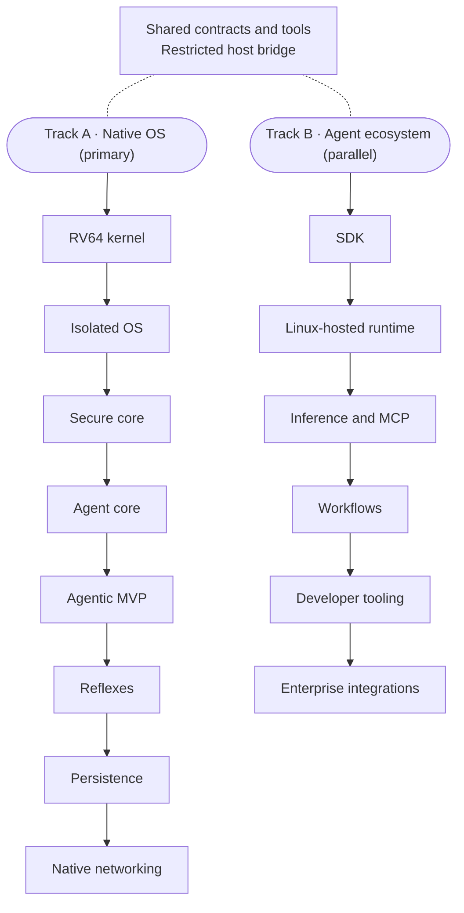

**Figure 23.3.** Arrows show the order within each track. Dotted lines connect the components they share.

Share agent definition schemas, tool contracts, goal and budget semantics, policy test vectors, event formats and SDK APIs. The native and hosted backends can have different enforcement mechanisms; document actual guarantees and run conformance tests on both. Track B can validate demand before Track A is production-ready, but must not replace it or become an architectural prerequisite for the native kernel.

The phases are dependency-oriented, not calendar promises. A solo developer can prioritize Track A and implement only the minimal hosted bridge and common interfaces needed for v0.4. AMD64 is now a strategic early port, not a late optional architecture. The core RV64 release is not blocked by the AMD64 port. Track C uses QEMU/TCG for cross-architecture testing, QEMU/KVM for commercial guest evaluation, and alternative VMMs only if justified.

### 23.4 Cross-product release gates

H and V release numbers are independently versioned and do not imply the same maturity as native v releases. The following are dependency targets, not delivery dates.

| Native release | Hosted milestone | Virtual milestone |
|---|---|---|
| v0.1 Foundation | H0.1: daemon/CLI and basic Linux sandbox | V0.1: reproducible RV64 boot under QEMU/TCG |
| v0.2 Secure Core | H0.2: goal-scoped sandbox controls and budgets | V0.2: isolated guest processes and capabilities |
| v0.3 Agent Core | H0.3: agent definitions and inference broker | V0.3: bounded host service transport; AMD64 boot work |
| v0.4 Agentic MVP | H0.4: minimal broker/bridge integration; H0.5: hosted workspace and approval features can progress independently | V0.4: real agent execution through the bridge, initially RV64 |
| v0.5 Reflex | H0.6: hosted reflexes and events | V0.5: AMD64/QEMU/KVM Goal Machine MVP; guest conformance, mediated egress and host-side teardown |
| v0.6 Persistence | H0.7: durable agent state and audit | V0.6: durable artifacts, disk support and controlled recovery |
| v0.7 Standalone | H0.8+: optional Wasm/microVM backend integrations | V0.7: expanded VM testing, optional native networking; no-NIC remains supported |
| v0.8+ Expansion | H0.9+: fleet management as justified | V0.8+: snapshots, Firecracker evaluation on AMD64 or direct-KVM VMM research |
| v1.0 Production | H1.0 only after hosted release gates | V1.0 only after virtual release gates |

**Priority order:** RV64 kernel foundation; secure agent primitives; early AMD64 bring-up; native agent MVP with host services; AMD64 Goal Machine MVP; then persistence, standalone networking and hardening. No custom VMM is required for these first commercial milestones. Section 30.4 is a subsystem roadmap aligned to these release gates, not a replacement for the master roadmap.

Useful related OS features include `stat`, `rename`, `mount`, hard/symbolic links, file permissions, pipes, `dup2`, independent executables and process-management calls. Do not implement all of POSIX merely for compatibility; prioritize the primitives needed by the security model and initial use cases.

## 24. First MVP: three isolated agents in QEMU

This is the native v0.4 Agentic MVP defined in Section 23.2, running on the actual Clavenar kernel in QEMU. Keep the first demonstration narrow. No robotics, distributed execution, accelerator, persistent disk or local transformer inference is necessary. Baseline authenticated action records are required for the MVP; extended replay and durable guest audit/recovery are later milestones. The trusted host broker persists accounting and external operation state before dispatch.

| Agent | Responsibility | Authority |
|---|---|---|
| Supervisor | Assign a goal, delegate tasks and review results | Limited delegation and goal control |
| Filesystem agent | Organize files in an authorized directory | Read/write private transaction; no arbitrary network/device access |
| Monitor | Observe resource use and report failures | Read-only inspection and reporting |

Run them in separate Sv39 address spaces with independent capability tables, event queues and budgets. Start with deterministic mock agents, then replace the planner with a mediated model service. Use the same enforcement mechanism for both.

### 24.1 Demonstration scenario

On native v0.4, start each run from the same known fixture with files under `/home/work` and `/private`. Give the filesystem agent a private transaction and permission to organize files only under `/home/work`. Use a fresh goal, budget and transaction for each outcome. Drive the denial cases with scripted requests so a cooperative model cannot mask a missing check.

Kernel 0.1.4 exercises the following cases with fixed workloads. In the publication example, `hello` stages the changes, a delegated `echo` supervisor reviews them, and a separate `echo` monitor observes the outcome. Each runs in its own address space. The shell owns the goal and authorizes publication. The model and MCP walkthrough uses a separate goal. Section 24.2 defines the wider acceptance criteria.

| Run | Required v0.4 result | Current RV64 evidence |
|---|---|---|
| Publish or discard | Stage the same rename in two runs. An independent check confirms the permitted scope and preserves file contents. On authorized commit only the reviewed change becomes visible. On discard the original tree remains intact. | The two-file fixture verifies both contents in `/home/work` and a sentinel in `/private`. The monitor reports either two published renames or a batch discarded on cancellation. [Both outcomes](https://github.com/clavenar/core/blob/beef26455e08273389673deec71e6ff2f3e50082/docs/qemu-walkthroughs.md#observe-a-reviewed-publication) · [Explicit discard](https://github.com/clavenar/core/blob/beef26455e08273389673deec71e6ff2f3e50082/docs/qemu-walkthroughs.md#discard-a-staged-rename) |
| Invalid result or stale review | Stage a result that loses required contents, or change the base after approval. Publication fails in each run and the committed tree preserves the authoritative version. | An incomplete batch or a changed protected input fails review. Editing a source after review produces a commit conflict. Both original names remain visible. [Failed postconditions and stale review](https://github.com/clavenar/core/blob/beef26455e08273389673deec71e6ff2f3e50082/docs/qemu-walkthroughs.md#publish-two-renames-in-one-commit) |
| Denied access or delegation | Request a read of `/private`, then request a grant outside the supervisor's authority. Check the denials at the resource handlers, the attributed audit entries and the absence of data in the reply. | RamFS denies an out-of-tree read and records `outside-read-scope` and zero bytes read. A goal allowing only `text.search@1` also rejects an agent’s attempt to delegate directly to `grep`. The audit identifies the caller. [Directory confinement](https://github.com/clavenar/core/blob/beef26455e08273389673deec71e6ff2f3e50082/docs/qemu-walkthroughs.md#limit-file-reads-to-a-directory) · [Delegation denial](https://github.com/clavenar/core/blob/beef26455e08273389673deec71e6ff2f3e50082/docs/qemu-walkthroughs.md#require-an-exact-tool-revision-for-a-goal) |
| Exhaustion | Competing child requests target the last available allocation. Admitted reservations fit the limit and the broker records no dispatch for the rejected work. | Two children compete for a local reply budget. In a separate broker run, the first plan spends one of two host units. A second plan needs two and is denied before dispatch. SQLite records zero units used for that refusal. [Child reservations](https://github.com/clavenar/core/blob/beef26455e08273389673deec71e6ff2f3e50082/docs/qemu-walkthroughs.md#reserve-reply-bytes-for-children) · [Host reservations](https://github.com/clavenar/core/blob/beef26455e08273389673deec71e6ff2f3e50082/docs/qemu-walkthroughs.md#run-a-host-backed-mock-plan) |
| Cancellation | Cancel with a local child active and a broker request outstanding. New dispatches stop, the child is cleaned up and its private changes cannot publish. The broker keeps any unsettled external reservation until reconciliation. | Cancelling a reviewed rename discards it. In the silent-plan fixture, cancelling after host dispatch stops `hello` before delegation or reading. The host journal retains the `in_flight` request and its two reserved units. [Publication cancellation](https://github.com/clavenar/core/blob/beef26455e08273389673deec71e6ff2f3e50082/docs/qemu-walkthroughs.md#cancel-a-reviewed-rename) · [Pending host request](https://github.com/clavenar/core/blob/beef26455e08273389673deec71e6ff2f3e50082/docs/qemu-walkthroughs.md#run-a-host-backed-mock-plan) |
| Real interoperability | In a fresh authorized run, use a real model, one local stdio MCP tool and one approved read-only remote MCP tool through the host. Check the durable host operation IDs and reconciled usage against the goal. | On a `search` decision, `find-greeting@8` invokes local `text.search@1` over guest stdio and `host.text.search@1` through the host broker. Ollama and the MCP Streamable HTTP server use host loopback. The journal ties separate model and tool request IDs and their usage to the same session, goal and launch. A `skip` ends the run before either search. [Combined Ollama and MCP run](https://github.com/clavenar/core/blob/beef26455e08273389673deec71e6ff2f3e50082/docs/qemu-walkthroughs.md#run-ollama-and-both-mcp-searches-in-one-goal) |

Native v0.6 requires recovery across reboots. The current fixtures cover atomic publication of two root-level files, recovery after a storage failure, and recovery of a host tool receipt without repeating the call. [Durable batch and recovery](https://github.com/clavenar/core/blob/beef26455e08273389673deec71e6ff2f3e50082/docs/qemu-walkthroughs.md#persist-two-renames-in-one-commit) · [Host tool recovery](https://github.com/clavenar/core/blob/beef26455e08273389673deec71e6ff2f3e50082/docs/qemu-walkthroughs.md#recover-a-host-mcp-search-checkpoint)

### 24.2 Minimum acceptance criteria

- Unauthorized user-mode memory accesses cannot read or write supervisor memory.
- Filesystem confinement cannot be escaped through absolute paths or parent traversal.
- A process cannot invent a valid capability or increase rights when deriving one.
- Parallel child agents cannot overspend a parent's reserved budget.
- An approval for one operation cannot authorize a different operation or resource.
- A required postcondition that fails or cannot be checked blocks publication. A stale base, changed diff or revoked grant invalidates prior authorization.
- Uncommitted changes do not affect the original filesystem.
- Audit entries contain trusted agent and goal identities, not just agent-supplied strings.
- A cancelled goal cannot submit new tool or inference requests; local children are cleaned up, and already dispatched requests have recorded outcomes without blind retries.
- Real external requests have host-side durable reservations and operation identifiers; no guest API keys or arbitrary network proxy are exposed.
- All tests have reproducible commands and observable pass/fail results.

## 25. Benchmark and evaluation plan

Compare equivalent workloads and security policies across:

- **Baseline A:** Linux plus a conventional agent framework.
- **Baseline B:** Linux plus hardened sandboxing, cgroups, mediated inference, transaction storage and a goal-aware runtime.
- **Experimental:** Clavenar OS on RV64 and, when available, AMD64 with equivalent mediated tools, security rules and agent/model behavior. For the virtual product also compare minimal Linux guests versus Clavenar guests on the same AMD64/KVM host, VMM and device profile; subsequently compare QEMU/KVM to a custom VMM/KVM with the same guest.

Use the same model, prompts, tools, inputs, approved effects, target architecture, memory constraints and VMM/device profile where applicable. Run recorded-model trials to isolate platform overhead, and live-model trials separately to measure end-to-end goal success and cost. Record build revisions, firmware, kernel configuration, compiler, host CPU, resource limits, sample counts, median and tail latency, variability and failed trials. Measure boot-to-ready (usable agent service), guest and VMM resident memory, allocated versus actual memory, and attributable shared broker overhead. Cross-ISA TCG runs are functional evidence, not a fair performance baseline. Do not use an insecure Linux baseline as proof that Linux is inherently insecure.

| Metric | Research objective |
|---|---|
| Boot time and resident memory footprint | Lower on equivalent dedicated systems |
| Agent creation and cancellation latency | Lower overhead and predictable cleanup |
| IPC and event wakeup latency | Efficient coordination |
| Unauthorized access attempts that succeed | Zero within the defined threat model and test set |
| Rights amplification and quota violations | Zero within the tested model |
| Agent recovery time | Faster recovery with correct state |
| Duplicate external effects after failure | Minimize; measure explicitly |
| Transaction commit and rollback latency | Efficient and correct publication/discard |
| Goal completion rate and deadline attainment | At least comparable with equivalent agent behavior |
| Tokens and cost per successful goal | Lower where scheduling improves efficiency |
| Energy per successful goal | Measure on real hardware, not infer from QEMU |
| Policy configuration complexity | Fewer independent mechanisms or configuration errors |
| Trusted computing base | Smaller or more understandable under the same threat model |
| Audit completeness and replay fidelity | More reliable attribution and reproduction |
| VM density and cost per completed goal | Measure end-to-end throughput and infrastructure cost at equivalent success and isolation |
| Cancellation under concurrent external requests | No new authorized operations after revocation; reconcile already dispatched effects |
| Reflex boundedness and latency | Verify instruction/helper limits, expiry, event-storm behavior and compare to hosted rules/eBPF |

### 25.1 Potential research questions

- Can goal descriptors unify authority, lifecycle, accounting and transactional state without enlarging the privileged kernel excessively?
- Can mandatory, goal-scoped capability mediation make prompt-injection containment easier to verify than application-specific sandboxing?
- What are the costs of hierarchical token and action budgets, revocation and bounded IPC?
- Can deterministic mock inference and recorded model responses reproduce agent failures reliably?
- How much overhead does default transactional execution introduce, and what storage strategies reduce it?
- Can a small RISC-V system deliver measurable memory, boot or energy advantages over a minimal hardened Linux configuration?

## 26. Threat model and non-goals

### 26.1 Threats to address

- Malicious or compromised agent code and untrusted model outputs.
- Prompt injection through documents, messages and tool responses.
- Attempts to bypass capability checks, escape directory scope, use stale handles or amplify delegated rights.
- CPU, memory, storage, queue, inference and economic resource exhaustion.
- Approval spoofing, replay or substitution.
- Crashes, lost responses, inconsistent state and repeated external actions.
- Sensitive data transmission through authorized tools or inference endpoints.

### 26.2 Initial non-goals

- General-purpose Linux replacement or full POSIX compatibility.
- An LLM in supervisor mode, a model deciding permissions, or model-dependent interrupt handling.
- Production-grade safety certification, complete formal verification or guaranteed real-time deadlines in the first prototype.
- Perfect prompt-injection prevention or rollback of arbitrary physical/network side effects.
- Full desktop environment, broad device support, distributed execution or on-device large-model inference in the MVP.

Physical attacks, compromised firmware, malicious host hypervisors, microarchitectural side channels and external provider compromises require separate threat-model assumptions and mitigations. Initial Virtual security assumes an uncompromised host, KVM/VMM and broker; the guest and its messages may be hostile to the host. Fine-grained guest-agent guarantees assume an uncompromised guest kernel. Hosted process isolation assumes the host kernel and sandbox configuration are trustworthy. No-NIC protects against direct guest socket egress but not exfiltration through authorized model or tool channels. Document these limits per backend rather than claiming protection outside the implemented boundary.

### 26.3 System invariants and validation

| Invariant | Required evidence |
|---|---|
| No ambient authority | New workloads receive only explicit handles; attempts to bypass brokers or directory confinement fail. |
| No rights amplification | Derivation and child creation cannot exceed the grantor's delegable rights. |
| No budget oversubscription | Concurrent reservations cannot exceed the parent's unspent allocation; checkpoints do not restore spent resources. |
| No unauthorized publication | Commit checks current authority, required postconditions, reviewed diff and base version together. A failed check leaves the published root unchanged. |
| No orphaned authority | Cancellation prevents new dispatches/grants and tears down local work; remote outcomes remain accounted for. |
| No unbounded privileged reflex | Verify program structure, helper cost, revocation and aggregate event limits. Disabling every reflex leaves rights and budget checks in force. |
| Restricted data egress | For a profile that promises label-based confinement, check recipients and artifact export as well as model and tool calls. Reject the profile when a required channel cannot enforce the label. |

These are engineering obligations, not claims that any current implementation already meets them.

## 27. Project identity and alternatives

Working name: **Clavenar OS**. Possible category description: *agent-native operating system* or *Autonomous Computing Operating System (ACOS)*. These are proposed positioning terms, not established technical standards.

The project uses **Clavenar** as its umbrella name, Clavenar OS for the native operating system and `clv` for the proposed management CLI. The website repository identifies `clavenar.io` as the project site. Trademark clearance remains open.

### 27.1 Five strongest selling points

1. **Secure autonomy:** Explicit, least-privilege authority enforced independently of the model.
2. **Reversible autonomy:** Inspect and discard private changes before committing them.
3. **Bounded autonomy:** Enforce computational, economic and action limits.
4. **Observable autonomy:** Trace mediated consequential actions to authenticated agents and goals.
5. **Persistent autonomy:** Recover authorized work after failures and restarts.

### 27.2 One-sentence project description

Clavenar OS is an open-source-oriented, capability-based, agent-native operating system and execution platform, written in Rust, RISC-V-first and designed for portability, secure autonomous goals, and conventional computation within explicit security, resource and accountability boundaries.

### 27.3 Manifesto

> Everything is a resource.  
> Every agent has a purpose.  
> Every action requires authority.  
> Every consequential action is accountable.

The objective is not to make an operating system intelligent at the expense of its security. It is to make autonomous intelligence a manageable, constrained and inspectable form of computation.

**Tagline:** Built for agents. Designed for trust.

**Brand architecture:** Clavenar OS (native), Clavenar Hosted (Linux runtime), Clavenar Virtual (native VM guests and Goal Machines), Clavenar Bare Metal (direct hardware), Clavenar VMM (optional dedicated VMM), Clavenar Guard (MCP security gateway), Clavenar Cloud (managed execution), Clavenar Edge (embedded), Clavenar Enterprise (fleet and governance), and Clavenar SDK (developer interfaces). These are proposed product names, not launched offerings.

## 28. Agentic Reflex Architecture (ARA)

The operating system should not rely on a model to respond to every event. A cognitive agent can propose a deterministic rule once; the system can execute that rule many times without further inference. This is the core idea of programmable reflexes, and a major research differentiator for Clavenar.

| Layer | Role | Location |
|---|---|---|
| L3 cognitive | Reasoning, diagnosis, learning, planning | User space or inference service |
| L2 executive | Workflow execution, tool selection, supervision | User space |
| L1 reactive | Verified event-driven programs with bounded actions | Restricted kernel engine or isolated service |
| L0 mechanisms | Memory protection, scheduling, interrupts, capabilities | Kernel |

The lower layers must remain operational if the model is unavailable or compromised. The term kernel agent refers to a restricted reactive program, not an LLM or arbitrary privileged Rust code. Many useful reflexes belong in user space; kernel residency must be justified by an actual privileged operation, latency requirement or measurable reduction in mediation overhead.

### 28.1 Candidate activities

Rights checks, quota admission and deadline enforcement belong to the resource handler even when every reflex is disabled. A handler can emit an event after its decision. Dropping or coalescing that event may delay a notification while the decision still holds.

| Event | Deterministic reflex | Intelligent follow-up |
|---|---|---|
| Memory pressure | Reclaim eligible caches; throttle authorized groups | Diagnose recurrent pressure |
| Capability denial | Aggregate denial events and notify the supervisor | Investigate suspicious behavior |
| Goal deadline or budget exhaustion | Notify the supervisor that new work has stopped | Replan within a new authorized budget |
| Process fault | Enforce bounded restart policy; publish event | Diagnose root cause |
| Storage pressure | Emit a threshold notification | Select archival strategy |
| Device threshold | Invoke predefined authorized response | Analyze anomaly |
| Transaction failure | Abort private changes | Develop alternative plan |
| Service outage | Notify supervisor; schedule recovery | Propose corrective procedure |

Suspending a process alone does not free its resident memory. Memory recovery must use actual cache reclamation, page release or a checkpoint-and-termination operation. Safety-critical devices must retain independent deterministic interlocks; a reflex is not automatically a certified real-time controller.

### 28.2 Reflex policy example

```yaml
name: protect_system_memory
owner: system-supervisor
trigger: memory.pressure
when:
  free_memory_below_bytes: 16777216
actions:
  - reclaim: eligible_cache
  - throttle: authorized_background_group
  - emit: diagnostics.memory_pressure
limits:
  actions_per_minute: 5
  expires_after_seconds: 86400
```

This is an illustrative proposal format. It grants no authority itself. The policy manager validates the requested object scopes, the verifier checks executable structure, and the dispatcher rechecks capabilities, expiry and budgets at execution time. An LLM cannot install or alter policy merely by producing this text.

### 28.3 Clavenar Agent VM (CAVM)

Start with a fixed-size rule interpreter in user space. If benchmarks justify it, introduce a tiny verified VM with typed registers, immutable verified programs, bounded scratch memory and an explicit helper interface. An eBPF-inspired design is useful prior art; do not claim restricted kernel programs themselves are novel.

```rust
// Conceptual bytecode; no raw pointers or arbitrary native calls.
enum Instruction {
    LoadMetric(MetricId),
    LoadImmediate(u64),
    CompareLess,
    JumpIfFalse(u16),
    RequestAction(ActionId),
    EmitEvent(EventId),
    Halt,
}
```

Example program: load free memory, compare it with 16 MiB, jump to `Halt` if sufficient, otherwise request a scoped reclaim action and emit a diagnostic event. `RequestAction` is an authorized helper, not a privileged bypass. The verifier rejects invalid targets, stack/register type errors, forbidden helpers and oversized programs. In the first version prohibit backward jumps and recursion, enforce a finite instruction count and preallocate all execution state. A helper may have greater cost than one VM instruction; account for helper work independently.

```rust
struct ReflexLimits {
    max_instructions: u32,
    max_memory_bytes: usize,
    max_actions_per_minute: u32,
    expires_at_ticks: u64,
}
struct KernelReflex {
    owner: AgentId,
    goal: GoalId,
    trigger: EventType,
    verified_program: ProgramHandle,
    authority: CapabilitySet,
    limits: ReflexLimits,
    enabled: bool,
}
```

The installation path copies the submitted program into protected storage, validates it and atomically publishes an immutable version. Bind event subscriptions to authorized sources; do not allow a user process to impersonate a privileged hardware event. Use per-reflex and global quotas, coalescing, bounded event queues, execution depth limits, rate limiting and explicit dropped-event accounting. Prevent reflex-generated events from causing recursive or cyclic event storms. Never block in interrupt context; queue work for an appropriate worker or trusted service. Revocation and goal cancellation prevent new executions, with defined handling for in-flight operations. Complex checkpoint, restart, network and filesystem operations normally belong to services rather than inside the VM.

Proposed control interface: `reflex_install`, `reflex_attach`, `reflex_enable`, `reflex_disable`, `reflex_replace`, `reflex_inspect`, `reflex_destroy`. Verification is mandatory at install/replace, independent of any advisory `verify` call. Include audit records identifying the program version, originating event, goal, actual helper request and result.

### 28.4 Learning into reflexes

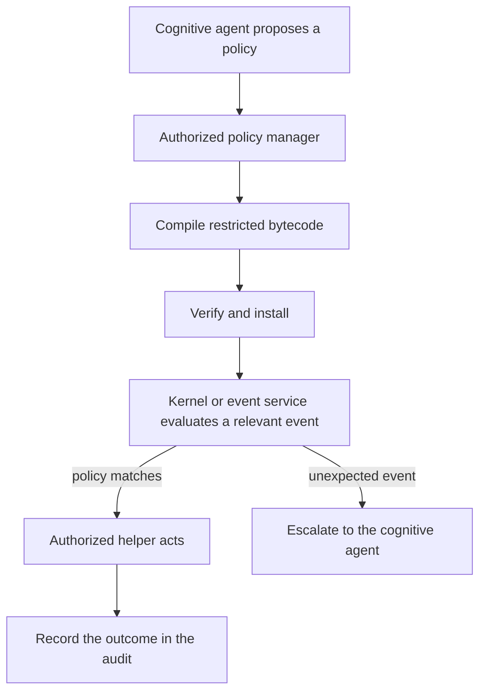

**Figure 28.4.** A verified reflex handles a matching event. An unexpected event goes to the cognitive agent for review.

This allows intelligence to propose new operational behavior without making intelligence part of the security boundary. Test policies in shadow/simulation mode before activation. A changed policy requires review according to its authority; agents cannot grant themselves new helpers. Compare inference calls saved, p50/p99 latency, energy on hardware, event throughput, verifier assurance and policy complexity against Linux with eBPF plus a user-space agent runtime. All performance advantages remain hypotheses.

## 29. Conventional userland, portable applications and tool contracts

The native prototype runs ordinary programs. The architecture also calls for services, persistent agents and bounded reactive programs. An agent identity may be suspended without a live process. A goal may include both agent and conventional child processes.

| Execution model | Example | Representation |
|---|---|---|
| Imperative | `grep -F Hello /hello.txt` | Native ELF or Wasm program |
| Intentional | `clv goal run "Diagnose failures"` | Goal, agent definition and runtime |
| Reactive | On storage pressure, emit alert | Verified rule/bytecode |
| Long-lived service | `mcpd`, `netd`, `modeld` | Supervised user process |

The native shell implements `ls` and `cat` as built-ins. Its `grep -F` command launches a separate ELF with a read-only file grant. Bounded stdin and stdout also connect the `hello` MCP client to the `grep` server. General handle mapping at spawn and utilities such as `cp`, `mv`, `find`, `sort`, `uniq`, `wc`, `ps` and `kill` remain planned. Native ELFs must match the target architecture and Clavenar ABI. Wasm/WASI is a later option. Full POSIX certification, Linux binary compatibility and a desktop remain outside the initial scope. [Pipes and streams](https://github.com/clavenar/core/blob/beef26455e08273389673deec71e6ff2f3e50082/docs/qemu-walkthroughs.md#send-data-through-stdin-and-stdout) · [Local MCP tool](https://github.com/clavenar/core/blob/beef26455e08273389673deec71e6ff2f3e50082/docs/qemu-walkthroughs.md#invoke-a-registered-file-tool-over-mcp)

### 29.1 Tool manifests

A conventional utility can expose a typed tool contract. The registry can translate that contract into an MCP tool schema without implementing the same functionality twice.

```yaml
name: text.search
version: 1.0.0
executable: /bin/grep
inputs:
  pattern: {type: string, required: true}
  source: {type: file_handle, required: true}
outputs:
  matches: {type: text_stream}
requested_capabilities: [read_input, write_output]
limits:
  cpu_ms: 100
  memory_mib: 8
  network: false
```

Do not trust a manifest's claimed side effects or determinism. Enforce the actual permissions of the executable and bind reviewed manifests to its version or content hash. Pass validated arguments without shell interpolation. Resolve file handles through the caller's capability table, not arbitrary paths supplied by the model.

A diagnostic agent can use `find`, `grep`, `sort` and `uniq` to aggregate logs, then use inference only to interpret the results. Spawn each program with an explicit subset of the parent goal's authority and a reserved budget. Goal accounting must include subprocess CPU, memory, streams, tool calls and inference usage. Cancelling the goal cleans up its associated processes, subscriptions, temporary handles and uncommitted transactions according to defined ownership rules.

### 29.2 Hybrid shell and namespaces

```text
clv:/$ ls /home
clv:/$ grep ERROR /var/log/system.log
clv:/$ clv goal run "Investigate recurring system errors"
clv:/$ clv goal inspect 42
clv:/$ clv goal diff 42
clv:/$ clv goal commit 42
clv:/$ clv reflex inspect 18
```

Retain `/bin`, `/sbin`, `/lib`, `/etc`, `/home`, `/tmp`, `/dev`; add virtual views of `/agents`, `/goals`, `/tools`, `/reflexes`, `/services`, `/models`, `/capabilities`, `/approvals`, `/audit`, `/snapshots`, `/sys` and `/mcp` as services become available. Access to virtual objects is mediated and cannot create rights through ordinary file writes.

## 30. MCP and secure tool interoperability

Model Context Protocol (MCP) should be a first-class user-space interoperability interface, not a syscall ABI. Clavenar acts as both client to external tools and server exposing authorized native services to external agents. Native IPC remains the efficient internal transport for resource handles and trusted identity. The kernel must not parse JSON, HTTP, OAuth or model prompts merely to support MCP.

| MCP feature | Clavenar mapping |
|---|---|
| Tools | Registered native executables or service methods |
| Resources | Authorized data and context views |
| Prompts | Optional context templates, never privileged instructions by default |
| Notifications and subscriptions | Authorized event routing where supported |
| Sampling | Mediated inference broker, if negotiated |
| Elicitation | Trusted user interaction service, if negotiated |
| Long-running task features | Goal lifecycle adapters, where supported |

Protocol versions and optional extensions evolve. Negotiate supported features; do not assume all servers provide them. Use the official specification and interoperability tests as implementation references rather than freezing an unverified feature list in the architecture.

### 30.1 Clavenar Guard and the MCP broker

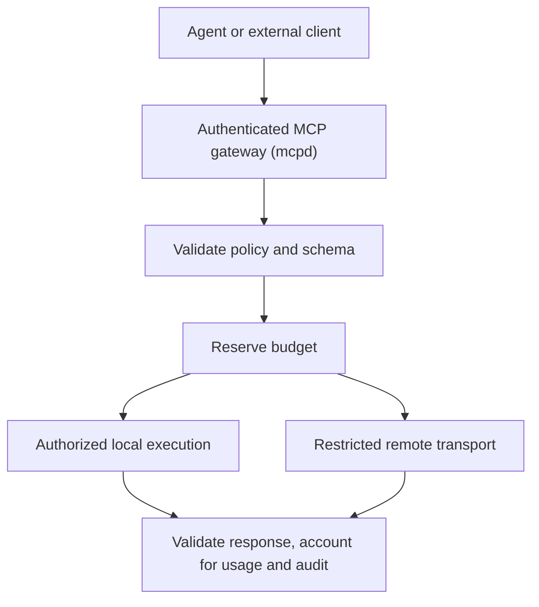

**Figure 30.1.** Local and remote MCP calls pass through the same admission and accounting steps.

The broker binds each invocation to its authenticated caller and authorized goal. It checks the server identity, registered tool version, scoped credential, arguments, expiry and permitted effect. For a local tool, its resource handlers enforce the allowed operations. For a remote tool, the guarantee also depends on the remote endpoint honoring the credential's scope and the agreed effect. Reject endpoints with unknown effects when a goal requires read-only execution. Negotiated MCP features describe what peers can speak. The broker determines what this caller may do.

```yaml
goal: Review source code
mcp:
  github:
    repository: clavenar/core
    allow: [read_file, list_issues]
    approval: [create_issue, create_pull_request]
    deny: [delete_repository, merge_pull_request]
  database:
    deny: '*'
budget:
  tool_calls: 100
  tokens: 50000
  deadline_seconds: 300
```

Names are illustrative; bind policies to the actual approved tool definitions and server identities. Approval must cover normalized arguments and the operation's target, not merely a tool name. Treat tool descriptions, annotations, resources and responses as potentially untrusted; pin or review schema changes and do not rely on self-declared `readOnly` or destructive hints. Protect credential storage, disallow token passthrough, validate server destinations, handle redirects and SSRF, bound request/response sizes and recursion, and record trusted attribution. Remote server internals are outside the guest kernel's control.

### 30.2 Effects and failure semantics

Classify effects using trusted policy: read-only, transactional, compensatable, irreversible or unknown. Only claim rollback for operations actually covered by a transaction. Email delivery, public posting, payments and physical actions generally cannot be undone by filesystem rollback. Stage requests and require explicit approval as appropriate. For ambiguous network failures, use durable operation identifiers, server-supported idempotency and reconciliation; do not blindly retry an operation whose outcome is unknown. Budget reservations must survive retries and checkpoint restoration.

### 30.3 Local tools and virtual inspection

Expose selected utilities as MCP tools (e.g. `text.search`, `crypto.hash`, `filesystem.list`, `system.processes`), all backed by the same native functions used by humans. Offer authorized inspection via `/mcp/servers/<server>/tools/<tool>/schema`, `policy`, `statistics` and `status`, with `clv mcp inspect`, `grant`, `revoke` and `connect` commands. Keep protocol and credentials in user space. A reflex can emit an authorized request for a user-space MCP dispatcher; it never performs blocking network operations in kernel context.

### 30.4 MCP delivery sequence and native OS release mapping

This section covers MCP delivery only. The native kernel/OS is delivered according to the master roadmap in Section 23; reproducible boot is the phase 0 exit criterion, with the first conventional OS release at v0.1 and secure IPC and pipes at v0.2. Do not postpone native kernel development until a Linux-hosted MCP gateway is complete. MCP is a user-space interoperability subsystem and never a kernel prerequisite.

| MCP step | Deliverable | Native dependency / release |
|---|---|---|
| 1 | Linux-hosted client/server and gateway using the official Rust MCP SDK (RMCP), with shared policy and tool contracts | Track B, parallel to native development; not a dependency for v0.1–v0.3 |
| 2 | Native guest tool invocation and local MCP over stdio, with bounded messages, JSON-RPC and per-tool authorization | Requires isolated processes and pipes from v0.1–v0.2, goal budgets and tool registry from v0.3; delivered in v0.4 (phase 10) |
| 3 | Restricted QEMU host bridge for remote tools and real model inference; no unrestricted command execution | v0.4 (phase 10), working with guest capabilities, approval checks and accounting |
| 4 | Expand the minimal native user-space MCP protocol implementation or port an SDK when its runtime dependencies are supported | Minimal local MCP delivered in v0.4; fuller protocol compatibility developed incrementally through v0.7 |
| 5 | Native remote Streamable HTTP, TLS, authorization and credential management after networking | v0.7 (phase 15), with native network policy enforcement; removes the mandatory bridge dependency for standalone mode (Virtual can remain broker-only) |
| 6 | Optional long-running task features, subscriptions and external agent-to-agent interoperability (e.g. A2A), negotiated where supported | v0.7+; prioritize according to use cases, maturity and interoperability tests |

The v0.4 milestone must demonstrate an agent executing on the native OS, using a local stdio MCP server, real mediated model inference and at least one approved remote MCP tool through the host bridge. The guest must be able to reject unauthorized actions without relying on model compliance. A hosted-only demo does not meet this milestone. At v0.7, repeat the relevant interoperability and policy tests with native networking and verified TLS, without the host MCP/inference transport proxy. The model itself may remain external.

Across all steps, keep MCP parsing, HTTP, TLS, authentication and credentials in user space; preserve the kernel's deterministic capability/IPC enforcement. Maintain a protocol-version compatibility matrix and test actual authorization, cancellation, rate limits and error handling. Basic audit is present by v0.4; replay, durable transactions and recovery improve in v0.5–v0.6. Remote effects cannot be assumed reversible or exactly-once merely because the local goal is transactional.

The 2025-11-25 MCP specification defines stdio and Streamable HTTP transports, negotiates versions and features during initialization, and marks the tasks facility experimental. Pin the version used in each interoperability run and record the features both peers negotiated. [Transports](https://modelcontextprotocol.io/specification/2025-11-25/basic/transports) · [Lifecycle](https://modelcontextprotocol.io/specification/2025-11-25/basic/lifecycle) · [Tasks](https://modelcontextprotocol.io/specification/2025-11-25/basic/utilities/tasks) · [Official Rust SDK](https://github.com/modelcontextprotocol/rust-sdk)

## 31. Clavenar Hosted: Linux implementation

### 31.1 Three deployment modes, one programming model

Clavenar Hosted is the proposed Rust agent runtime on an unmodified Linux kernel. In today’s QEMU prototype, agents run inside the Clavenar guest and a Python broker on Linux handles selected external requests. Clavenar Virtual uses this guest execution model. Bare Metal would run the native kernel directly on supported hardware.

| Mode | Kernel executing agents | Intended use |
|---|---|---|
| Hosted | Linux | Developer compatibility, existing applications and early enterprise adoption |
| Virtual | Clavenar guest OS, with a Linux/KVM or QEMU host initially | Isolated Goal Machines and dedicated autonomous workloads |
| Bare Metal | Clavenar OS directly on supported hardware | Embedded devices, research, offline autonomy and hardware/software co-design |

All modes share logical goal, policy, agent-definition, capability, tool, event and budget contracts; native binaries and backend guarantees are not necessarily portable. Expose backend features and security guarantees explicitly. Reject a workload that requires unavailable isolation or revocation rather than silently downgrading it. Linux-hosted remains useful even after the native kernel matures: it is the compatibility layer, research baseline and provider/MCP service host for early virtual machines.

### 31.2 Control plane, execution plane and Linux enforcement

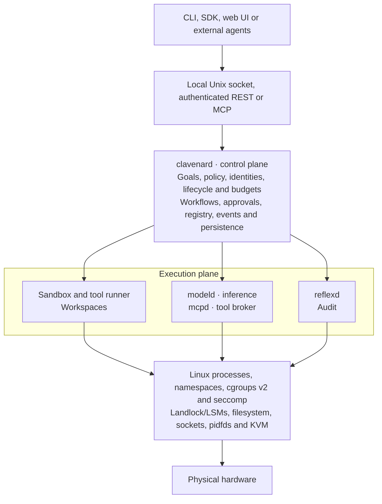

**Figure 31.2.** In Hosted mode, `clavenard` manages goal policy and lifecycle. Linux enforces the restrictions on workloads and brokers.

Begin with a modular control daemon (`clavenard`), not a fleet of microservices. Separate the privileged sandbox launcher, untrusted workloads, credentials and network-facing brokers into restricted processes when needed for security. The daemon authenticates users and service identities and manages goal state; the kernel enforces the actual process restrictions. A trusted broker, not an agent-supplied `goal_id`, identifies a caller using authenticated IPC and its assigned execution/session context.

| Service | Responsibility |
|---|---|
| clavenard | Goal creation, supervision, policy, cancellation, lifecycle and recovery |
| sandbox runner | Construct restricted process environments before executing untrusted code |
| modeld | Model adapters, protected credentials, request reservations, usage and streaming |
| mcpd | Approved MCP server registration, tool authorization, schema/argument checks and execution |
| tool runner | Launch conventional programs with explicit arguments, resource handles and quotas |
| storage/transaction service | Private workspaces, conflict detection, diff, commit and discard |
| approvald | Authenticated, operation-bound approval and denial |
| reflexd | Deterministic event-driven rules in user space; optional selected eBPF hooks later |
| audit service | Durable action provenance, operations journal and authorized inspection |
| clavenar-vmd | Optional VM lifecycle manager, isolated from the general agent runtime |

A local Unix socket is sufficient for the initial SDK and CLI. Remote APIs require authentication, scoped authorization, transport security and request limits. An external agent may use Clavenar as a restricted execution backend without adopting its planning loop.

### 31.3 Mapping goal objects to Linux resources

Each hosted goal owns a logical policy and lifecycle record, a sandbox/process group, a cgroup subtree, a workspace, delegated authority, inference and action accounts, event subscriptions and an audit journal. A child goal receives a subset of the parent's authority and an atomically reserved allocation of its available resources. The system must not trust agent cooperation to maintain these restrictions.

| Abstraction | Hosted implementation | Native implementation |
|---|---|---|
| Goal identity | Trusted daemon record linked to isolated resources | Kernel-managed goal handle plus runtime metadata |
| Capabilities | Protected broker handles, selected file descriptors, sandbox rules | Native capability table and rights checks |
| Process and memory isolation | Linux process address spaces and MMU protection. Namespaces, credentials and LSMs restrict access to host resources. An optional VM adds a guest boundary. | Hardware page tables and kernel process objects |
| CPU and memory quotas | cgroups v2; cumulative accounting and cancellation | Kernel resource accounting and scheduler |
| IPC and events | Unix sockets, pipes, pidfds, timerfd, epoll, inotify, netlink | Native typed IPC and kernel events |
| Transaction | Copy/reflink, OverlayFS or filesystem snapshots plus commit service | Goal-scoped transactional VFS |
| Reflex | User-space rule engine; selected verified eBPF hooks where justified | Restricted native reflex engine |
| Inference and remote effects | Trusted brokers | Trusted brokers, protected by native kernel mechanisms |
| Agent checkpoint | Durable logical state | Durable logical state, optional native checkpoint |

Use cgroups to enforce memory, process count and CPU bandwidth limits; a cumulative CPU-time budget additionally needs accounting and a defined response to exhaustion. Linux cgroups do not count inference tokens or remote costs. The broker must reserve such budgets separately, including in-flight operations, then reconcile results. For real provider calls, persist reservations and operation state from the first release supporting those calls (H0.3/H0.4); H0.7 expands this into full logical checkpoint and recovery support. Stop new requests on cancellation even if an already submitted external operation cannot be stopped.

### 31.4 Sandbox profiles and revocation

The initial Hosted backend runs Linux native processes (including existing Python and Rust programs). Later backends can use WebAssembly/WASI and microVMs. Use a maintained sandbox launcher where possible; do not treat a single Linux primitive as a complete isolation system.

- Construct a minimal read-only base filesystem and narrowly scoped writable workspace. Isolate mount, PID and network namespaces as appropriate. Drop unnecessary Linux capabilities, prevent privilege escalation, apply syscall filtering and supported mandatory filesystem restrictions, and close unnecessary inherited handles before executing untrusted code. Do not expose host container-engine sockets, raw devices, host credentials or arbitrary host paths.
- Deny arbitrary network egress; allow only authenticated, authorized broker paths. A generic proxy or arbitrary URL fetch can bypass tool restrictions and must not be provided by default. Broker endpoints must be isolated from unrelated host services.
- Prevent escape from the assigned cgroup and supervisor hierarchy. Use pidfds and appropriate cgroup controls to terminate all local work. Explicitly cancel associated broker sessions, budgets, timers and child goals.
- Linux cannot universally revoke an already-open file descriptor in an uncooperative process. Retain sensitive resources behind a broker when immediate revocation is needed, or destroy the affected sandbox. Document the distinction from native capability revocation. Neither approach can undo information already read or an externally committed operation.
- Apply threat-model-specific limits to process, Wasm and VM profiles. Shared-kernel isolation is not equivalent to hardware virtualization; a separate VM is a candidate for hostile multi-tenant workloads, not a guarantee of immunity to escape or side channels.

### 31.5 Workspaces, persistent state and hosted reflexes

For a repository job, give the sandbox an immutable input snapshot and a private writable workspace. Linked Git worktrees share repository data, including branch refs and, by default, configuration. Keep the original repository and shared writable Git metadata outside the sandbox. A broker can export the reviewed result and conditionally advance the authorized ref from the expected base. That operation publishes a Git revision. [Git worktree sharing rules](https://git-scm.com/docs/git-worktree#_refs) · [Conditional ref updates](https://git-scm.com/docs/git-update-ref)

Atomic visibility for a live directory tree requires a backend that exposes the entire reviewed version in a single switch. An overlay can isolate private writes. Durable publication also requires recovery of the committed version after a crash. Reject goals whose required guarantee is unavailable. [Linux OverlayFS](https://docs.kernel.org/filesystems/overlayfs.html)

Store goals, agent definition hashes, budgets, reservations, operation states, approvals, event subscriptions and logical checkpoints in SQLite initially; PostgreSQL is an optional later multi-node backend. Keep credentials outside workspace files. Use durable operation identifiers and a state machine (reserved, dispatched, confirmed, failed, unknown) for external actions. Reconcile unknown outcomes instead of automatically repeating them. Preserve audit and billing state across restarts.

`reflexd` interprets the same restricted rule definitions proposed for native kernel reflexes, using Linux event sources and Clavenar broker notifications. It runs in user space, so its timing, availability and atomicity are different from a kernel reflex. Selected eBPF hooks can be investigated when existing program types and helpers support the required behavior; do not generate arbitrary kernel code or assume eBPF can execute every native action. Shared test vectors should establish semantic equivalence for supported operations and flag unsupported ones.

### 31.6 Shared implementation contracts

```rust
// Illustrative domain interface; backend-specific handles remain opaque.
pub trait ExecutionBackend {
    type Error;
    type ProcessHandle;
    type WorkspaceHandle;

    fn features(&self) -> BackendFeatures;
    fn spawn(&self, spec: &AuthorizedProcessSpec)
        -> Result<Self::ProcessHandle, Self::Error>;
    fn create_workspace(&self, goal: GoalId)
        -> Result<Self::WorkspaceHandle, Self::Error>;
    fn resource_usage(&self, goal: GoalId)
        -> Result<ResourceUsage, Self::Error>;
    fn cancel_goal(&self, goal: GoalId)
        -> Result<(), Self::Error>;
}
```

The types above are proposed interfaces, not compiled source. The public SDK must distinguish requests from already-authorized internal objects; callers cannot construct a trusted `AuthorizedProcessSpec` merely by serializing one. Enforce trust and ownership at every backend boundary. Shared Rust crates should contain deterministic policy logic, domain types, protocol formats, schema validation, budget arithmetic, reflex semantics and conformance tests. Use `no_std` for suitable core crates; keep Tokio, database and Linux-specific code out of the native kernel. Keep wire formats versioned, with fixed-width values, size limits and explicit serialization rather than transmitting native Rust layouts.

Hosted technology candidates: Rust, Tokio, Axum, Reqwest, rustls, Serde, SQLx/SQLite, RMCP, Wasmtime, Clap and OpenTelemetry. Verify dependencies, platform requirements, licenses and security posture before adoption. A Python SDK over the authenticated public API is simpler initially than porting a complete Python runtime to the native OS.

### 31.7 Hosted delivery gates

| Release | Deliverable / exit gate |
|---|---|
| H0.1 | Daemon, CLI, goal identity and single-node Linux process sandbox |
| H0.2 | Explicit authority, resource controls, supervision and cancellation without orphan processes |
| H0.3 | Versioned agent definitions, modeld, mock and real model adapters; durable external request reservations and budget checks |
| H0.4 | mcpd, registered tools and the restricted native-guest bridge |
| H0.5 | Private workspaces, diff, explicit publication and operation-bound approvals |
| H0.6 | Deterministic hosted reflexes, events and policy conformance |
| H0.7 | Durable logical checkpoints, accounting, audit and tested recovery |
| H0.8 | Optional Wasm and hardware-isolated execution backends, tested separately |
| H0.9 | Fleet/deployment management and enterprise features if demand is established |
| H1.0 | Supported production profiles, hardening, isolation review, recovery, compatibility and operational documentation |

Native v0.4 needs a working approval path for its reviewed guest changes and a durable host journal before its first real external request. It can use a small trusted reviewer and broker while Hosted develops its own workspace publication at H0.5. Hosted H0.7 adds full agent checkpoints and recovery. These tracks share contracts and can release independently.

## 32. Clavenar Virtual and Goal Machines

### 32.1 Native OS as a specialized guest

Clavenar Virtual is a way to deliver our own kernel without asking users to replace their host OS. Each VM runs Clavenar's native kernel, userland, capability system and agent runtime. The Linux host schedules the virtual CPUs and enforces the outer VM resource limits; the guest schedules its own processes and agents. A host-side control plane and service brokers manage the goal's outer authority and lifecycle.

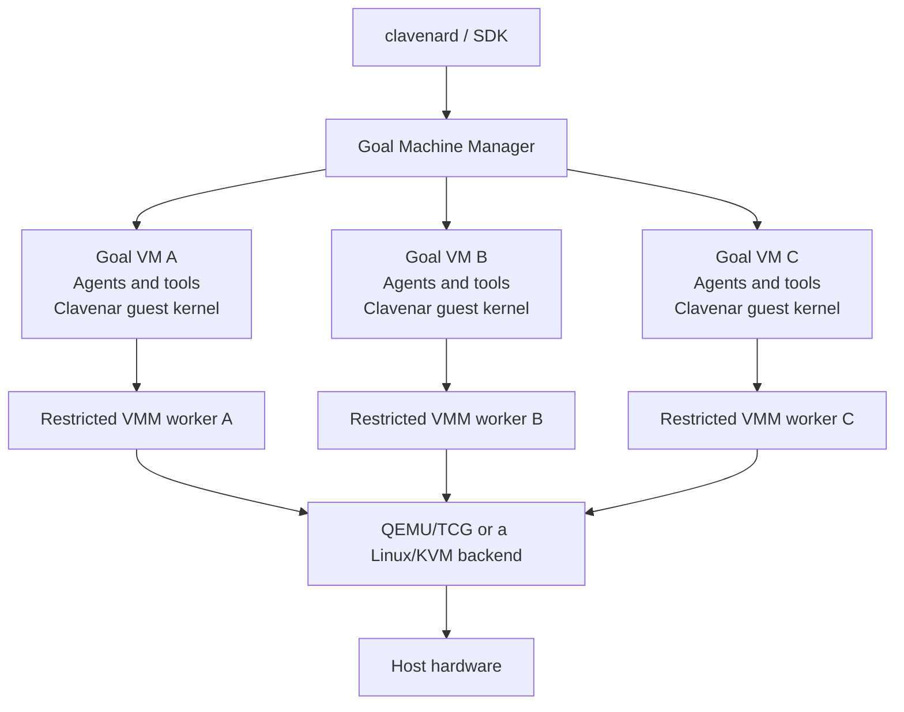

**Figure 32.1a.** Each Goal Machine has a guest kernel and a dedicated VMM worker.


**Figure 32.1b.** Each VM reaches its authorized services through an authenticated channel to the host brokers.

The system can eventually operate in three VM isolation modes: one VM for cooperating agents in a trust domain; one VM per independent agent; or one VM per goal with multiple agents and conventional tools inside it. The last is the recommended first commercial product hypothesis: a disposable **Goal Machine**. Guest-level protection limits what processes inside a machine can do; outer virtualization isolates separate machines. A machine may outlive an individual process or inference request, but its authority is tied to a bounded goal lease. A Goal Machine initially executes Clavenar-native tools and mediated services, not arbitrary Linux ELF binaries, full Python environments or existing Linux compilers. Use a Linux sandbox/microVM backend where a workload requires these dependencies; disclose which guest kernel is executing it.

### 32.2 QEMU TCG versus KVM

QEMU TCG translates RV64 guest instructions on an AMD64 development host. It is an excellent debugging and CI platform but is not the expected high-density deployment mechanism on AMD64. QEMU can also use KVM to run matching-architecture guests with hardware-assisted virtualization. Most ordinary guest instructions then execute directly on the physical CPU, with VM exits and device handling managed by the VMM and KVM.

| Host | Guest | Initial approach |
|---|---|---|
| AMD64 | RV64 | QEMU TCG emulation |
| AMD64 | AMD64 | QEMU/KVM with accessible hardware virtualization |
| RV64 | RV64 | QEMU/TCG or KVM where hardware, kernel and platform support it |

AMD64 means x86-64, including compatible Intel processors. KVM availability depends on the host kernel, processor, permissions and cloud/nested virtualization policy. An AMD64 port is necessary for efficient native guest execution on AMD64 but does not by itself make Clavenar compatible with every VMM or boot protocol.

### 32.3 Minimal virtual hardware and bridge

| Device / facility | Purpose |
|---|---|
| Virtual CPU, RAM, interrupt controller and timer | Boot, paging, scheduling, deadlines |
| UART/console | Boot diagnostics, interactive development |
| VirtIO-console/serial or vsock | Dedicated host service transport; choose based on supported platform |
| VirtIO-block | Persistent or scratch storage when required |
| VirtIO-rng | Trusted entropy input on supported platforms |
| VirtIO-net | Optional native networking, not required for Goal Machines |
| VirtIO-fs, balloon, vTPM | Later, only if security/operational needs justify them |

The RV64 broker runs the guest with `-nic none`. After building the kernel, run this command at the Linux prompt in the Core repository.

```sh
python3 platforms/qemu-riscv64-virt/host_bridge.py --budget-units 2
```

The broker starts QEMU, creates a private Unix socket and connects it to port 0 of a modern VirtIO console. After a successful guest–host handshake, the UART prints `host bridge ready` and then the `clsh>` prompt. This command exercises the mock planner. Broker options select local Ollama or the approved host MCP fixture. The host reserves each request against its own session budget and records the outcome in SQLite. [Bridge and boot handshake](https://github.com/clavenar/core/blob/beef26455e08273389673deec71e6ff2f3e50082/docs/qemu-walkthroughs.md#probe-the-qemu-host-bridge) · [Budget and journal walkthrough](https://github.com/clavenar/core/blob/beef26455e08273389673deec71e6ff2f3e50082/docs/qemu-walkthroughs.md#run-a-host-backed-mock-plan)

The production Goal Machine design binds the channel to a short-lived authenticated machine lease. The host must enforce aggregate limits independently of guest-supplied identifiers and authorize each external operation. Future approval, artifact and credential services require their own scoped operations. A guest with no NIC can still send data through its permitted services.

For a future AMD64 bootable disk, an illustrative development command is `qemu-system-x86_64 -machine q35 -accel kvm -cpu host -m 128M -smp 1 -nographic -nic none -drive file=clavenar-amd64.img,format=raw`. That image and its boot and device contracts belong to the AMD64 port.

### 32.4 Goal Machine contract and lifecycle

```yaml
goal:
  objective: Review a repository and propose fixes
  agent_definition: developer@1.0.0
machine:
  architecture: amd64
  isolation: vm
  memory_mib: 128
  vcpus: 1
  deadline_seconds: 600
  network: none
capabilities:
  repository: read_only
  workspace: private_write
  inference: approved_model
  mcp: [approved_repository_read]
budget:
  tokens: 50000
  tool_calls: 100
  max_cost_usd_micros: 2000000
  child_agents: 2
transaction:
  commit_requires_approval: true
```

Illustrative values are not measured resource requirements. Goal Machines should be image-versioned, resource-bounded and individually identifiable.

1. Authenticate the requester and resolve a signed/versioned guest image and agent definition. Validate the goal's requested policy against actual authority and backend features.
2. Reserve host resources and inference/action budgets; establish a scoped machine lease, private input snapshot/workspace, per-VM channels and audit identity.
3. Start a restricted VMM process and boot the guest. Establish the service session and deliver only the authorized goal configuration, not unrestricted host credentials.
4. Run native guest processes, agents and tools. The guest enforces fine-grained capabilities and quotas; the host brokers independently enforce aggregate machine authority and costs. Monitor both planes.
5. Return artifacts, a transaction diff and attributable audit records via mediated channels. Treat guest-provided files and metadata as untrusted; validate paths, links, sizes and formats on the host.
6. The trusted host storage service owns publication. A reviewer with a separate live commit grant can review a retained diff after guest execution ends. Goal cancellation or expiry invalidates pending publication as specified in Section 6.2.
7. On completion, cancellation or deadline, revoke the machine lease, refuse new external operations, terminate the VMM and remove temporary data according to retention policy. Preserve accounting and authorized audit records, reconcile pending external operations and release host allocations.

A VM is not an autonomous transaction covering the entire external world. VM destruction cannot undo external API effects or cancel an already accepted remote operation unconditionally. Host lifecycle and budgets must remain authoritative across guest snapshots, restarts and replays.

### 32.5 VM manager and snapshots

`clavenar-vmd` manages versioned VM images, per-VM worker processes, resources, boot, console, service sessions and cleanup. For QEMU use a private QMP management channel and a narrowly scoped launcher. Never expose QMP to agents or give them generic VMM control. Apply cgroups and sandboxing to workers, minimize virtual hardware and prevent arbitrary host paths/devices from being selected by guest requests. A VMM crash should not grant additional authority or lose the host's billing and external-effect state.

```sh
clv vm create --arch riscv64 --memory 128MiB
clv vm start vm-42
clv vm console vm-42
clv vm inspect vm-42
clv vm destroy vm-42
# Preferred end-user API: manager chooses the VM backend.
clv goal run --isolation vm review-project.yaml
```

Commands are proposed CLI contracts. Distinguish logical agent checkpoints, filesystem snapshots and full VM checkpoints (RAM, vCPU and supported device state). Full VM restore requires compatible VMM/guest/platform state, quiescence of devices and defined behavior for outstanding host requests. Before resuming, re-establish authorization, reconcile in-flight effects, revoke obsolete session handles and restore only the remaining budget from a trusted host account. Never restore host spending limits from a guest snapshot. Migration and warm pools are later optimizations; wipe prior guest data, session identity and mutable resources before reusing a machine.

### 32.6 Virtual delivery gates

| Release | Deliverable / exit gate |
|---|---|
| V0.1 | RV64 QEMU boot and reproducible image/build |
| V0.2 | Guest memory/process isolation and capability tests |
| V0.3 | Bounded, authenticated service transport; begin AMD64 bring-up |
| V0.4 | Real native guest agents using host inference/MCP, no NIC needed; durable host-side request and spending records |
| V0.5 | AMD64/QEMU/KVM Goal Machine MVP; launch, cancel, artifact review and no-bypass tests |
| V0.6 | Persistent/scratch block storage, durable artifact publication and recovery |
| V0.7 | Wider VM integration and optional native networking; no-NIC profile remains available (not a dependency of Goal Machines) |
| V0.8+ | VM checkpoint experiments, pools, Firecracker on AMD64 or direct KVM research, as justified |
| V1.0 | Supported hardened production deployment with independent review, tested isolation, resource control, recovery, documented platform matrix and operational procedures |

These revised virtual milestones supersede earlier suggestions to postpone AMD64 until late expansion. Native release v0.5 and Virtual V0.5 are intended convergence targets, not a requirement to delay RV64 releases if AMD64 slips.

## 33. AMD64 and a QEMU-independent Clavenar VMM

### 33.1 Strategic architecture priority

| Target | Role |
|---|---|
| RV64 | Reference design, QEMU development, research and future embedded hardware |
| AMD64 | Early second port, commercial Goal Machines on commodity servers, KVM and alternative VMMs |
| WebAssembly | Architecture-independent application format through a restricted runtime, not a CPU port |

Separate architecture-specific boot, interrupt entry, paging, context switching, syscall conventions, CPU-local state, timers and SMP support from common kernel logic. Keep portable capabilities, goals, budgets, IPC semantics, reflex bytecode and filesystem logic in shared code. Define architecture-neutral syscall numbers and fixed-width public types; actual register conventions differ. Hardware abstraction contracts must specify lifetime, alignment, memory ordering, interrupt/preemption and unsafe requirements. Avoid assuming RISC-V's memory ordering or trap behavior applies on another architecture.

| Facility | RV64 | AMD64 |
|---|---|---|
| Privilege | S/U mode | Ring 0 / ring 3 |
| Paging | Sv39 (initial) | Four-level long-mode paging (initial) |
| Syscalls | ecall / sret | syscall and appropriate sysret/iretq return |
| Trap setup | stvec, supervisor CSRs | GDT, TSS, IDT, syscall MSRs, exception stacks |
| Timers/interrupts | SBI/architectural timer, PLIC or AIA | APIC timer/interrupts and supported virtual clock |
| Boot | OpenSBI/QEMU virt | Compatible bootloader/firmware or direct VMM boot contract |
| Rust target | riscv64gc-unknown-none-elf | x86_64-unknown-none |

The early AMD64 port should target a deliberately small virtual machine profile before general PC hardware. Test user/kernel isolation, register preservation, interrupt safety and return-to-user validation on both architectures. Use the same conformance suite for native goal/capability behavior. VirtIO transport (MMIO versus PCI) and interrupt setup may vary, while queue and device logic can be reused.

### 33.2 Can we remove QEMU?

Yes, on a suitable Linux/KVM host running a compatible guest architecture. KVM is the Linux kernel's hardware virtualization facility, exposed via `/dev/kvm`. It does not, by itself, provide the complete userspace machine model, boot loader, device backends or lifecycle manager needed by a guest. QEMU is one VMM; Firecracker and Cloud Hypervisor are other examples of VMMs that can use KVM without QEMU. Our own Rust process could do so as well.

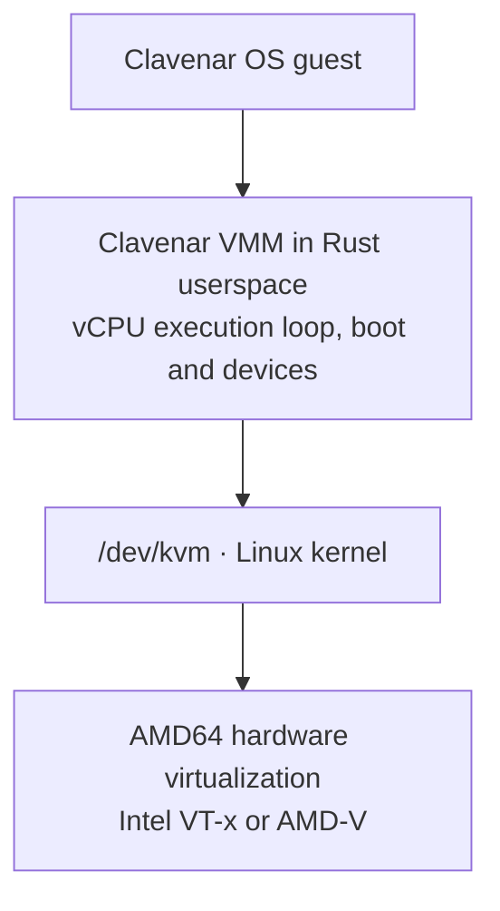

**Figure 33.2.** The optional Clavenar VMM supplies the userspace machine model. Linux KVM provides hardware-assisted virtualization.

The term **Clavenar VMM** denotes this optional native-host VMM, not the agent runtime, VM manager or a replacement for KVM. Removing QEMU does not remove Linux from the virtualization host; nor does it give us cross-architecture emulation. Continue using QEMU TCG for RV64 on AMD64 hosts. Keep QEMU/KVM as the first commercial virtualization backend so that custom VMM work does not delay Goal Machines.

### 33.3 Minimal VMM responsibilities and direct boot

Use the Rust `kvm-ioctls`, `kvm-bindings`, `vm-memory`, `vmm-sys-util`, `virtio-queue`, `event-manager` and other appropriate rust-vmm building blocks. An existing kernel loader may be useful if it supports the chosen executable and boot contract; do not assume a generic Linux loader understands a custom Clavenar image.

The initial direct-KVM experiment can be one vCPU with fixed RAM, a simple debug console and no network. The VMM opens `/dev/kvm`, checks API version and required capabilities, creates a VM and allocates/registers host memory as guest physical memory. It loads a validated kernel image into guest RAM, initializes architectural state and creates a vCPU. On AMD64, define a versioned direct-boot ABI: image layout/entry, memory map and reserved ranges, page-table assumptions, stack, CPUID features, register arguments, interrupt/timer configuration and boot information. Validate ELF segment bounds and overlap; do not confuse guest virtual and physical addresses. A firmware-free boot is feasible because we control both kernel and VMM, but must be implemented and tested explicitly.

The VMM configures KVM's supported interrupt-controller/timer facilities, executes vCPUs using `KVM_RUN` and handles exits that need userspace action. It supports required I/O port reads/writes, MMIO, shutdown and errors; add interrupts, entropy, storage and a service transport incrementally. A `HLT` exit is not inherently guest shutdown: a running OS may idle pending interrupts. Treat explicit shutdown, halt/wakeup, interrupted host execution and fatal errors separately. Multi-vCPU execution, device concurrency, dirty-page tracking and snapshots are later tasks.

```rust
// Schematic only: boot memory, registers, devices and error handling omitted.
use kvm_ioctls::{Kvm, VcpuExit};

let kvm = Kvm::new()?;
let vm = kvm.create_vm()?;
// Allocate/register guest memory; load image; configure platform and interrupt state.
let mut vcpu = vm.create_vcpu(0)?;
// Configure CPUID, special registers, general registers and boot state.
loop {
    match vcpu.run()? {
        VcpuExit::IoOut(port, data) => devices.io_write(port, data)?,
        VcpuExit::IoIn(port, data) => devices.io_read(port, data)?,
        VcpuExit::MmioWrite(addr, data) => devices.mmio_write(addr, data)?,
        VcpuExit::MmioRead(addr, data) => devices.mmio_read(addr, data)?,
        VcpuExit::Hlt => wait_for_interrupt_or_stop()?,
        VcpuExit::Shutdown => break,
        other => handle_supported_exit_or_fail(other)?,
    }
}
```

This is a design sketch, not a runnable VMM. The minimal virtual platform should use standardized VirtIO devices when practical. Omit unneeded VGA, USB, audio, firmware and legacy PC components rather than recreating QEMU. Multiplex inference, MCP and artifact services over a single well-defined communication channel; no custom CPU instruction or separate inference device is required. Define platform-specific device discovery and a boot ABI independently of the common Clavenar syscall ABI.

### 33.4 Backend selection and security

| VMM backend | Role |
|---|---|
| QEMU/TCG | Cross-architecture kernel development and CI |
| QEMU/KVM | First accelerated AMD64 Goal Machine backend |
| Firecracker | Candidate for high-density deployment if compatible boot and virtual devices are implemented |
| Clavenar VMM/KVM | Optional purpose-built VMM after evaluation |
| Other KVM VMMs | Evaluate only for demonstrated deployment needs |

A VMM backend interface should expose features for image boot, create/start/stop, resource limits, service channel, optional snapshots and destroy. Unsupported mandatory features cause rejection. Firecracker is not automatically able to boot any custom ELF or disk image: implement its required boot protocol, virtual hardware and guest drivers first. Reuse an established VMM unless the dedicated VMM has a clear measured advantage.

Treat all guest RAM, MMIO, I/O, virtqueue descriptors and service messages as hostile inputs. Validate bounds, sizes, arithmetic, descriptor chains, resource ownership and state transitions; prevent unbounded queue processing and resource exhaustion. Avoid raw pointers into mutable guest-controlled structures without a validated access model. Isolate each VMM worker with minimal host privileges, restricted host file descriptors, appropriate sandboxing and cgroups; avoid embedding provider credentials into the VMM. The trusted host gateway validates the complete operation independently of the guest kernel and prevents generic host access. A VMM compromise remains a serious boundary failure; KVM, host Linux, device code and brokers all belong in the threat model. Fuzz device and protocol parsers, test adversarial guests and seek independent security review before production use.

### 33.5 Implementation and evidence gates

1. RV64/QEMU reference kernel and portable HAL.
2. AMD64 boot, paging, trap entry, timers and isolated user processes (begin v0.3).
3. AMD64 native goal/tool conformance on QEMU/KVM, bridge and Goal Machine lifecycle (target V0.5).
4. Benchmark against a minimal equivalent Linux guest and assess customer needs.
5. Evaluate Firecracker or other existing VMM compatibility.
6. Prototype direct KVM boot using a small Rust VMM, single vCPU, console and explicit guest boot ABI (optional V0.8+ work).
7. Add only necessary devices and host service transport; demonstrate equivalent isolation and lifecycle behavior.
8. Compare QEMU/KVM and Clavenar VMM/KVM on identical guest images, hardware, device profiles and workload. Measure boot-to-ready time, per-VM resident memory (including VMM), CPU and I/O overhead, tail latency, concurrency, failure recovery and security/maintenance burden.
9. Invest in hardening, snapshots and deployment only if the measured improvements justify maintaining another privileged component.

Both KVM backends use hardware-assisted CPU execution; removing QEMU does not inherently make guest CPU instructions faster. Potential gains are smaller VMM footprint, fewer device interfaces, direct boot and tighter lifecycle integration. QEMU's maturity, tooling and portability are significant advantages. A new VMM is a research/optimization option, not a promised performance or security improvement.

Reference starting points (verify current API versions and platform requirements during implementation):

- [Linux KVM API](https://docs.kernel.org/virt/kvm/api.html)
- [QEMU system documentation](https://www.qemu.org/docs/master/system/index.html)
- [rust-vmm ecosystem](https://github.com/rust-vmm/rust-vmm)
- [rust-vmm KVM bindings and VM creation API](https://docs.rs/kvm-ioctls/latest/kvm_ioctls/struct.Kvm.html#method.create_vm)
- [Firecracker](https://github.com/firecracker-microvm/firecracker)
- [Cloud Hypervisor](https://github.com/cloud-hypervisor/cloud-hypervisor)

## 34. Shared inference service and networking strategy

### 34.1 Inference is a managed service, not a kernel HTTP client

External LLM providers generally expose HTTPS APIs. MCP's local stdio transport does not require networking; remote MCP and cloud inference do require networking somewhere, but that does not have to be in the guest. Preserve one provider-independent `modeld` contract across deployment modes.

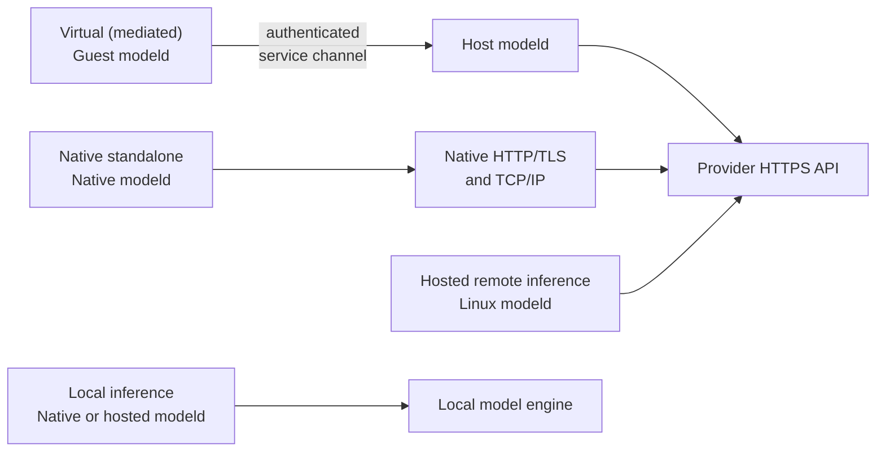

**Figure 34.1.** A mediated guest sends inference requests through the host broker. A standalone guest can contact the provider using its own network stack.

| Mode | Networking required for inference |
|---|---|
| Hosted | Linux supplies networking for remote providers. |
| Virtual, mediated | The host supplies TCP/IP. The guest uses the service channel. |
| Native standalone | The guest needs TCP/IP for a remote HTTPS provider. |
| Local inference | A local engine can run offline. |

Implement a deterministic mock first. Next, implement real provider adapters in the hosted broker. Reuse those adapters for virtual guest requests rather than maintaining separate provider-specific guest protocols. Port or adapt the service to native user space once the networking and runtime dependencies exist. A commercial no-NIC Goal Machine can retain the mediated transport even after the standalone release. The model API, credential provider and actual inference engine remain replaceable.

```rust
// Conceptual asynchronous service contract (poll is nonblocking).
pub trait InferenceProvider {
    fn submit(&mut self, request: AuthorizedInferenceRequest)
        -> Result<RequestId, InferenceError>;
    fn poll(&mut self, id: RequestId)
        -> Result<InferenceStatus, InferenceError>;
    fn cancel(&mut self, id: RequestId)
        -> Result<CancelStatus, InferenceError>;
}
```

Use an opaque model handle and authorized request context, not a provider URL or API key supplied by the agent. Define message, tool-call, streaming chunk, usage and error formats, bounded buffering, backpressure and timeout semantics. The guest-host channel may multiplex model, MCP, artifact, approval and audit services with length-delimited versioned frames and request IDs. Authenticate requests to the machine lease, derive goal authority from trusted state, reserve maximum permitted usage before dispatch, reconcile observed usage, handle cancellations and unknown outcomes, and ensure retries cannot replenish a budget. If the provider cannot bound the charge, the broker rejects requests subject to a hard cost ceiling (Section 9). API credentials remain in trusted brokers, never in an agent definition or guest image. Model and tool output is untrusted content.

### 34.2 Native networking at v0.7

On the private QEMU link, the user-space `netd` uses smoltcp and the kernel’s VirtIO-net driver to answer ARP and IPv4 pings and to echo UDP and TCP. The `http-probe` build also issues a plain `GET /probe`. [Ethernet and IP](https://github.com/clavenar/core/blob/beef26455e08273389673deec71e6ff2f3e50082/docs/qemu-walkthroughs.md#exchange-an-ethernet-frame-over-virtio-net) · [HTTP](https://github.com/clavenar/core/blob/beef26455e08273389673deec71e6ff2f3e50082/docs/qemu-walkthroughs.md#fetch-an-http-response-over-native-tcp)

With `tls-probe`, each grant admits one operation for a live goal agent. The build profile sets the guest IPv4 address and prefix, resolver, optional gateway and primary HTTPS peer. It can also define a secondary peer. Each peer has a hostname, pinned IPv4 address, HTTPS port and DER trust anchor. The goal owner chooses a peer with `goal create --https-peer primary|secondary`. The default is primary. The kernel binds each request ID to the launch and the selected peer. One deadline covers the request’s frame I/O. `netd` checks the DNS answer against the kernel-supplied IPv4 pin and verifies the selected hostname and certificate chain before sending HTTP. The default fixture uses `probe.clavenar.test:8443` at `192.0.2.3`. The guest uses VirtIO RNG for entropy and the RTC for certificate dates. [Authority and frame I/O](https://github.com/clavenar/core/blob/beef26455e08273389673deec71e6ff2f3e50082/docs/native-syscall-abi.md#goal-authorized-https) · [Network profile](https://github.com/clavenar/core/blob/beef26455e08273389673deec71e6ff2f3e50082/README.md#configure-a-native-network-profile)

The goal owner can set a shared transmit allowance with `--https-tx-bytes N`. VirtIO queue acceptance spends the full Ethernet length of each request-tagged frame. When a frame exceeds the balance, the kernel stops frame I/O for the exchange. The owner can inspect the retained charges and remaining bytes with `goal budget`. An omitted allowance is unlimited and still counts bytes sent.

The QEMU fixture compares these charges with frames on the link, verifies that a 192-byte allowance stops the next frame after DNS and the TCP SYN, and calls the other peer from a fresh goal in the same boot. Separate runs reject the primary address and CA when the goal selects the secondary. [Two-peer QEMU walkthrough](https://github.com/clavenar/core/blob/beef26455e08273389673deec71e6ff2f3e50082/docs/qemu-walkthroughs.md#select-an-https-peer-per-goal)

An MCP initialization grant covers the initialize request and its notification. Discovery adds `tools/list` and validates one `text.search` descriptor with a required string `pattern`. An invocation grant covers those steps and one `tools/call` with `pattern=Hello`. The kernel returns up to 64 bytes of validated text to the submitting agent, and queuing the reply spends its length from the goal budget. The host fixture terminates TLS and forwards MCP messages to a loopback server for the QEMU walkthrough. [Native MCP call](https://github.com/clavenar/core/blob/beef26455e08273389673deec71e6ff2f3e50082/docs/qemu-walkthroughs.md#call-the-mcp-search-tool-over-native-https)

| Layer | Remaining standalone scope |
|---|---|
| Device and IP configuration | Validate static address, resolver and route configuration on deployed networks. Physical NIC drivers require board-specific support and DMA isolation. |
| HTTPS | Define redirect policy, deadlines and response limits for general HTTPS requests through approved services. |
| Services | Support additional approved remote tools and carry provider requests where required. Keep credentials in trusted user-space services. |
| Policy and accounting | Extend peer configuration beyond two destinations and admit additional operations through scoped grants. Check each new connection and redirect against destination policy. Extend traffic accounting to additional approved services and incoming traffic. |

In the standalone design, agents request network operations through `modeld` and `mcpd`. Conventional applications can request scoped network authority. Confidentiality policies also require trusted data provenance and explicit declassification at egress. [smoltcp project](https://github.com/smoltcp-rs/smoltcp)

## 35. Agent definitions, instruction hierarchy and portable packages

In the proposed Native architecture the kernel binds local execution contexts and handles to authenticated identities and goals. The runtime pins the agent definition hash and interprets its instructions. Hosted and Native can use the same definition when the backend supports its dependencies and required guarantees. The runtime verifies package identity and requests authority from the trusted authorizer.

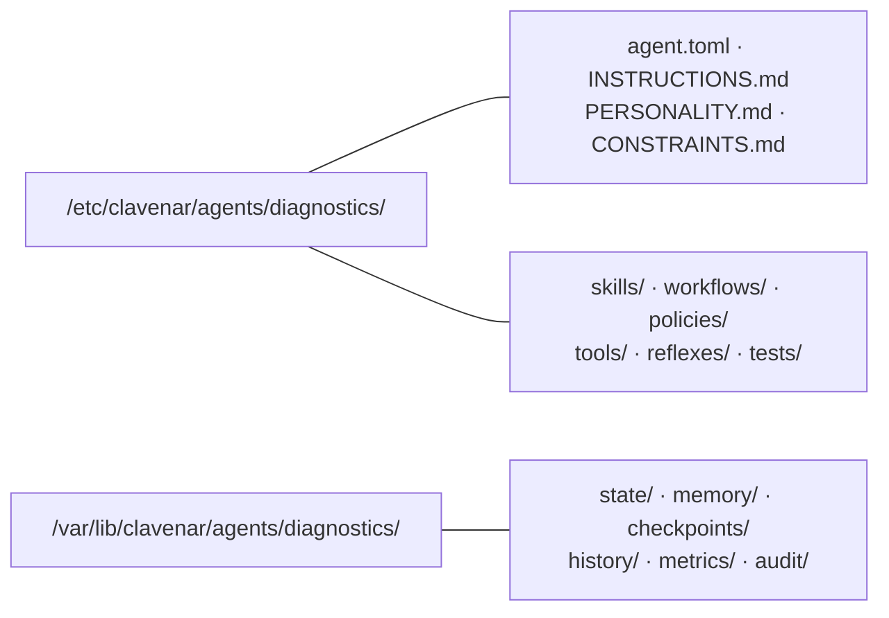

**Figure 35.** The diagnostics agent has a reviewed definition under `/etc/clavenar/agents/diagnostics/` and writable runtime data under `/var/lib/clavenar/agents/diagnostics/`. The definition includes these example files.

| Package directory | Files |
|---|---|
| `skills/` | `log-analysis.md`, `memory-diagnostics.md` |
| `workflows/` | `diagnose.yaml` |
| `policies/` | `capabilities.toml`, `network.toml`, `approvals.toml` |
| `tools/` | `native.toml`, `mcp.toml` |
| `reflexes/` | `failure-monitor.yaml` |
| `tests/` | `scenarios.yaml` |

Separate immutable reviewed instructions and manifests from writable memories and runtime state. Retain provenance, package versions, skill hashes and the policy version used by each goal. Agent memory, remote tool output, MCP resources and external documents are untrusted context rather than higher-priority instructions.

```toml
# Proposed manifest syntax, not a published standard.
[agent]
name = "diagnostics"
version = "1.0.0"
persistent = true

[instructions]
system = "INSTRUCTIONS.md"
personality = "PERSONALITY.md"
constraints = "CONSTRAINTS.md"

[model]
provider = "approved-default"
max_context_tokens = 32768

[budget]
cpu_time_ms = 30000
memory_mib = 64
tokens_per_goal = 50000
tool_calls_per_goal = 100
max_child_agents = 2
max_cost_usd_micros = 1_000_000

[events]
subscribe = ["service.failure", "memory.pressure"]

[security]
default_policy = "deny"
transactional = true
allow_self_modification = false
```

All numbers are illustrative requested limits and must be validated against the actual grant. The instructions might specify evidence collection, deterministic tool preference, root-cause investigation, escalation and verification procedures. Load task-relevant skills selectively; skills cannot confer additional authority. Structured workflows can coordinate deterministic tool steps, model analysis, operation-specific approval, authorized action and verification. Inheritance/templates reuse instructions and settings but must not amplify capabilities. A supervisor can authorize definition updates; running goals pin their definition version by default, while policy revocations take effect immediately.

| Layer | Function / enforcement |
|---|---|
| Kernel invariants | Non-overridable memory protection and resource authority |
| Organization policy | Enforced by trusted policy brokers and kernel restrictions |
| Agent definition | Reviewed role, instructions, skills and requested settings |
| Supervisor and current goal | Authorized task and additional constraints |
| Environmental context and memory | Untrusted observations, never independent authority |

Use Markdown/TOML and a structured workflow format initially. Later, a signed `.clv` agent package could include instructions, workflows, native or Wasm components, schemas, reflex definitions and tests. A package registry could support provenance, version pinning and review of permission requests before installation. An optional Agent Definition Language (ADL) may compile into prompt text, typed policy requests, workflow definitions, budgets and verified reflex bytecode. Do not implement a custom language until common semantics and security tests are stable.

Test definitions against deterministic scenarios and recorded model responses; evaluate proposed reflexes before approval. Store version hashes and decisions for auditing, but do not claim access to hidden model reasoning. Logical checkpoints should retain compatible state and authority references, not bypass revocation or restore consumed budgets.

## 36. Commercial positioning and validation

### 36.1 Product strategy

Clavenar is infrastructure for autonomous intelligence, not a general-purpose Linux replacement. The most promising near-term commercial hypothesis is secure goal-scoped execution, initially on Linux and then using native Clavenar Goal Machines on existing AMD64 servers. Native OS development remains the primary engineering objective; the hosted implementation reduces adoption friction and contributes shared components and a strong comparison baseline.

| Product | Proposed value |
|---|---|
| Clavenar OS/Core | Open kernel, agent model, SDK and reference implementation |
| Clavenar Hosted | Existing Linux application compatibility, goal-scoped sandboxing and agent services |
| Clavenar Virtual | Native guest OS, disposable Goal Machines and mediated host access |
| Clavenar Guard | MCP and tool authorization, inference/data policies and audit gateway |
| Clavenar Cloud / Enterprise | Managed or private execution, fleet management, identity, compliance tooling and support |
| Clavenar Edge / Bare Metal | Dedicated autonomous devices, industrial integration and hardware partnerships |

Prefer a permissive open-source core, provisionally Apache 2.0 for its explicit patent grant and commercial interoperability, subject to dependency/license review. Keep essential enforcement, protocols and SDKs inspectable; do not reserve fundamental security for paid editions. Commercial differentiation can come from management, operations, support, integrations, validated releases, private deployment and managed execution. Consider MPL 2.0 if reciprocity for modified covered files becomes important. Establish contribution governance, a vulnerability disclosure process, dependency policy and trademark clearance. These are recommendations, not an assertion that the code has already been licensed or the brand cleared.

Target design partners with constrained agent execution needs: repository review, private enterprise automation, data processing, incident diagnostics or industrial monitoring. Start with read-only repository analysis and staged report/file generation using native utilities and approved external services; full coding workloads requiring a conventional Linux toolchain can use Hosted until a compatible native toolchain exists. Dedicated bare-metal hardware and robotics are later opportunities; safety-critical physical control requires independent deterministic safety mechanisms and relevant assurance. Interview prospective customers, determine the inadequacies of their existing Linux-based tools, and prioritize a narrowly defined paid pilot. Prices and demand need validation; no revenue forecast is assumed.

### 36.2 Concrete proof of value

The value proposition is not exclusive features inaccessible to Linux. It is the integration of goal descriptors, capability revocation, bounded delegation, transactional publication, accountable tool/inference usage and verified reflexes into one execution contract, potentially with lower overhead or simpler security assurance. Hosted should use existing mature Linux primitives instead of reproducing them. Native should prove whether a smaller specialized guest kernel produces measurable incremental value.

Use the common evaluation protocol in Section 25 for all claims, including comparisons against a hardened Linux agent runtime and a minimal Linux/KVM guest. Section 26.3 supplies the security invariants. The commercial pilot should demonstrate a bounded goal, at least one useful approved tool, a denied prohibited action, staged results, cancellation and auditable costs. For customer discovery, measure time to deploy and maintain policy, actual completion rate and the cost of obtaining equivalent security guarantees. Establish a measurable advantage before investing in a custom VMM, broader hardware support or production multi-tenancy.

Compare QEMU/KVM, alternative VMMs and any custom Clavenar VMM only after equivalent guest functionality exists (Section 33.5). Record remaining trust assumptions and failures; do not extrapolate theoretical RAM-based VM density into production capacity. The business case for a custom VMM must exceed its ongoing maintenance and security assurance costs.

**Strategic conclusion:** RISC-V establishes the reference architecture and enables hardware research; AMD64 enables commercial hardware-accelerated native guest deployments; Hosted opens the existing Linux ecosystem; Virtual delivers the actual Clavenar kernel without OS migration; Bare Metal enables standalone and embedded use. Goal Machines are the proposed product unifying native OS innovation and practical adoption. A dedicated VMM is a later conditional investment, not another prerequisite on the critical path.

## Appendix A — Glossary

| Term | Meaning in Clavenar |
|---|---|
| ABI | Application Binary Interface: machine-level calling, layout and syscall conventions. The common logical API can map to different architecture-specific ABIs. |
| Agent | Persistent autonomous identity that may execute through one or more processes over its lifetime. |
| Goal descriptor | Protected handle to a goal's authorized scope, lifecycle, resource budget, delegated work and transaction references. |
| Goal contract (GCEA) | Authorized, versioned constraints on a goal's effects, limits and required checks. Resource handlers enforce them at dispatch and publication. |
| Capability | Kernel-managed or trusted-broker-managed handle granting specified rights to a resource; not an MCP feature flag. |
| HAL | Hardware abstraction layer separating generic kernel mechanisms from CPU and platform details. |
| Sv39 | RV64 three-level virtual memory scheme used for the reference kernel's address-space isolation. |
| SBI / OpenSBI | Supervisor Binary Interface and an open-source implementation, typically in RISC-V machine-mode firmware. |
| MCP | Model Context Protocol; user-space interoperability for tools, resources and context. It does not replace authorization. |
| modeld | Trusted inference broker providing provider routing, credentials, requests and usage accounting. |
| Reflex / CAVM | Verified, bounded event-triggered policy; Clavenar Agent VM is the proposed restricted interpreter. |
| TCG / KVM | QEMU's dynamic translation engine / Linux's hardware virtualization interface. |
| VMM | Virtual machine monitor; manages a guest's memory, CPUs, virtual devices and lifecycle. QEMU is one example. |
| Goal Machine | An isolated VM running the native Clavenar OS for a bounded goal, using host-mediated services where appropriate. |
| TCB | Trusted computing base: all components whose correct operation is needed for a specific security guarantee. |
| Checkpoint / snapshot | Saved execution or storage state; does not rewind external services or already incurred spending. |
| WASI | WebAssembly System Interface: portable host interfaces for Wasm components. |

## Appendix B — Implementation decision checklist

Before expanding beyond the current release gate, record the supported platform/profile, ABI or protocol version, threat assumptions, actual enforcement points, expected failure behavior, reproducible tests and observed results. Keep a dated architecture decision record for significant changes. In particular:

- **Native v0.1:** prioritize boot reliability, complete trap handling, page allocation, address-space isolation, safe user copying and independently compiled programs.
- **Native v0.2–v0.4:** freeze the minimal goal/capability semantics and define authorization, cancellation, budget and publication conformance tests before attaching real models or external tools.
- **Virtual V0.5:** require AMD64/KVM guest conformance, a restricted host service channel, machine lease revocation, artifact handling and reproducible teardown. Do not require native guest TCP/IP or a custom VMM.
- **Native v0.5:** migrate only justified reflex actions to the kernel after verifier, helper and event-rate tests; keep ordinary policies in user space.
- **Production:** declare a supported security profile, verify all mandatory guarantees across the relevant trust boundary, obtain independent review and maintain a vulnerability response and release process.

The decision to proceed with later ports, local inference, Firecracker or a dedicated Rust VMM depends on demonstrated need and evidence. The authoritative release sequence remains Section 23.
